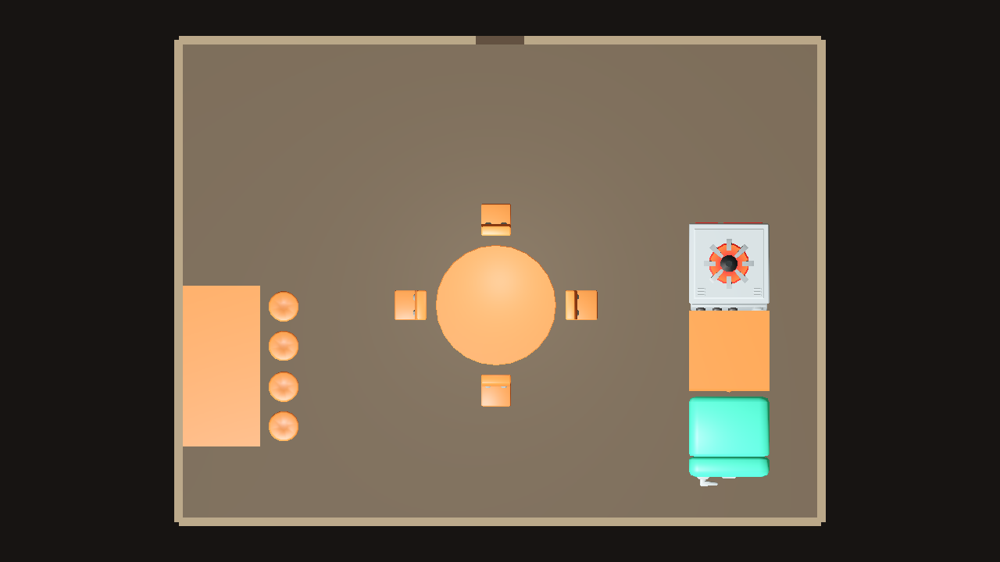
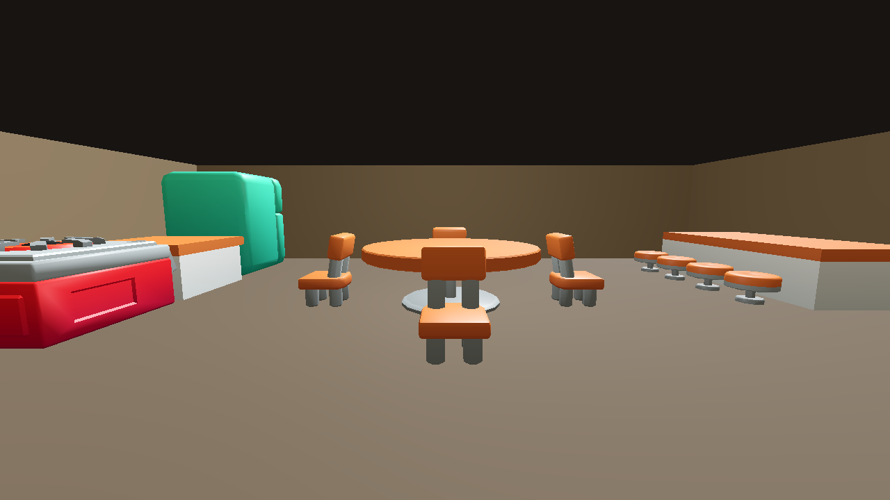
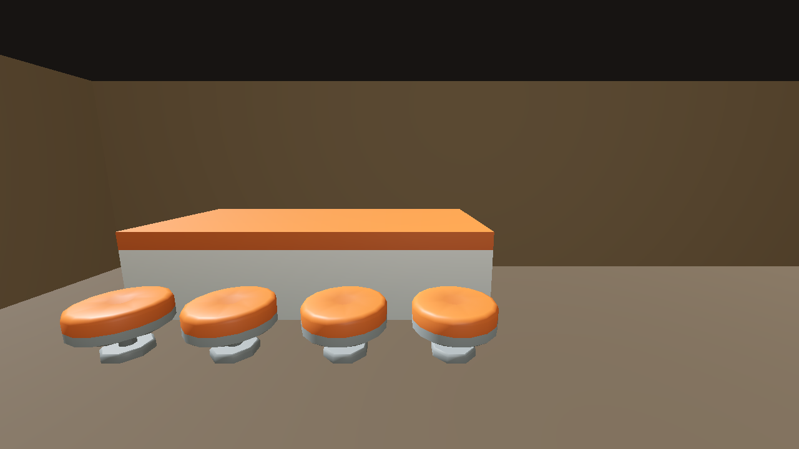
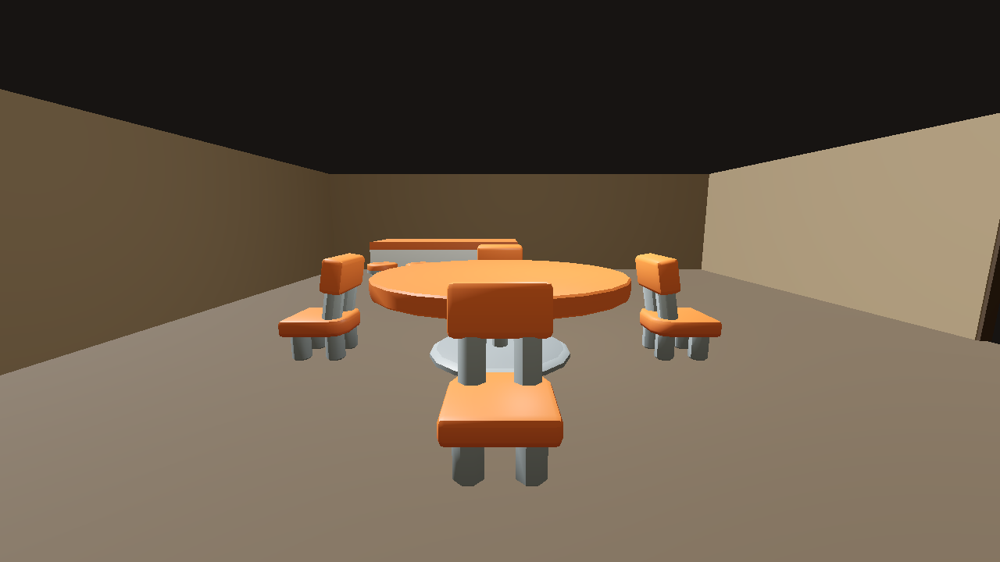
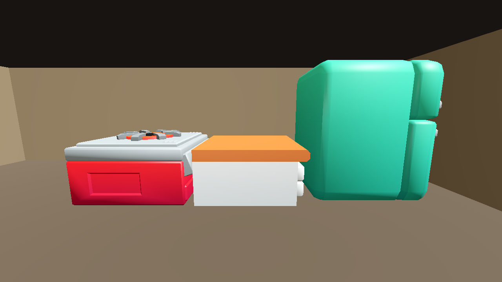

# FittingPlacer tavern experiment (LAY-01 / Issue #24)

## Assessment: GO for this standalone layout proof

FittingPlacer's unchanged placement code generated all 14 requested pieces from the authored face relationships in [`tavern.xml`](tavern.xml). The generated result has a two-section continuous counter with four stools along one customer side, a round table with four inward-facing chairs, and a stove-counter-fridge kitchen line. The room is 16 × 12 m with a centered south entrance. The JSON in [`godot_preview/layout.json`](godot_preview/layout.json) contains the solver's unmodified positions and rotations; the isolated Godot 4.7.1 loader applies those transforms directly to the KayKit scenes.

The top-down and four eye-level captures below show the actual Godot scene. In the entrance view, the route into the room and the aisle between the furniture groups appear open. This is a visual observation for this one generated result, **not** a route guarantee from FittingPlacer.

### Top-down



### First-person views









## What the solver computes

The test uses FittingPlacer commit `1cdb703197b41d418e7ce686e74c7aad835ddb37`, a C# implementation dual-licensed MIT/CC0. Its original projects target .NET Framework 4.6, which was unavailable here. `runner/Runner.csproj` compiles the upstream `Main/*.cs` source files unchanged against the available .NET 9 runtime; no solver logic is reimplemented.

FittingPlacer loads model sizes, four typed faces, pairwise face relations, clearances, room/door dimensions and an input list of model IDs from the XML. It selects at most **one furniture relation per fitting** and a separate wall relation where authored. Related placements become a group. It searches a discretized room grid for valid positions and quarter-turn rotations while checking overlaps and authored clearance areas. A zero-distance face relation joins touching edges; a positive distance sets a gap. The fixed seed makes this experiment repeatable.

Input authoring affected the outcome as expected: the first run attached the second bar segment by its right end, so FittingPlacer correctly joined the segments but their customer faces pointed in opposite directions. I changed that model's authored join face to its left end and reran the same seed. The resulting sections share orientation and all four stools occupy the same customer side. No placement coordinates or seeds were manually adjusted or searched.

It does not infer relationships from KayKit meshes, choose tavern zones, identify the customer side, or validate global routes. Those semantics and dimensions are authored explicitly in `tavern.xml`. The south door's local opening clearance is considered, and clearances are authored behind the dining chairs and stools and in front of the kitchen appliances. There is no pathfinder or route-connectivity check.

## Authored relationships and generated result

| Group | Authored relationship | Generated result |
| --- | --- | --- |
| Bar | Section A right end attaches to section B left end at 0 m; A's back attaches to a wall; both sections have a distinct front/customer face. | Both counter sections aligned in one 4 m run against the west wall, with the same orientation. All four stools attach to the customer face, two per section. |
| Dining | Each chair's front face attaches 0.25 m from one of the round table's four typed edges. Chair width and side clearance limit the support edge capacity. | Four chairs, one on each side of the table, facing inward. |
| Kitchen | Stove back attaches to the counter front at 0 m; refrigerator front attaches to the opposite counter back at 0 m. Their front clearances reserve working access. | Stove, counter and refrigerator generated in a straight line, in a separate area of the room. |
| Entrance | South door center `(0, -6)`, width `1.2 m`, inward normal `+Y`; the solver reserves its immediate opening area. | Furniture groups fit without occupying the doorway. The entrance view visually shows a clear aisle into the room. |

The JSON records each output as an `assetId`, `assetPath`, `translation` and `rotation`, plus the original solver X/Y/orientation for traceability. Godot maps solver `(x, y)` to world `(x, 0, z)` and maps the solver's positive quarter-turn to Godot's negative Y rotation. The loader does not move or rotate placements after reading JSON. Camera positions and static room shell geometry are preview-only.

## KayKit dimensions and license

The models come from KayKit Restaurant Bits 1.0 at pinned commit [`153c8a7535b48237854cb54ff6890679f8c574d1`](https://github.com/KayKit-Game-Assets/KayKit-Restaurant-Bits-1.0/tree/153c8a7535b48237854cb54ff6890679f8c574d1), whose included license is CC0. The source and license are already recorded in [`docs/assets_provenance.md`](../../../docs/assets_provenance.md); the experiment includes only the selected glTF/bin pairs, their shared atlas and license. No new external assets or license were introduced.

Dimensions below are the model bounds in meters, X × Y(height) × Z, read from the glTF positions; the refrigerator bounds include its translated door meshes. FittingPlacer expects floor-plane width/depth, so the XML uses X and Z extents.

| Model | Measured bounds | Solver footprint (width × depth) |
| --- | --- | --- |
| `table_round_A` | 3 × 1 × 3 | 3 × 3 |
| `chair_A` | 0.75 × 1.208 × 0.796 | 0.75 × 0.797 |
| `chair_stool` | 0.75 × 0.5 × 0.75 | 0.75 × 0.75 |
| `kitchencounter_straight_A` | 2 × 1 × 2.042 | 2 × 2.042 |
| `stove_single` | 2 × 1.208 × 2.288 | 2 × 2.288 |
| `fridge_A` | 2 × 2.5 × 2.24 | 2 × 2.24 |

KayKit's available stool seat is 0.5 m high while the counter top is 1.0 m high. The experiment preserves both measured model scales, so the generated stools read lower than a conventional bar stool in the close view. The solver provides the requested side relationship, but it does not fix this asset proportion mismatch.

## Reproduce

Requirements: PowerShell, Git, .NET 9 SDK, and Godot 4.7.1 console executable. From the repository root:

```powershell
powershell -ExecutionPolicy Bypass -File experiments/layout_solvers/fittingplacer/capture.ps1
```

The script obtains the pinned upstream solver into ignored `.local/FittingPlacer` if needed, runs it once with seed `4242`, writes the JSON, imports the isolated Godot project and saves the five screenshots. Pass `-GodotExe C:\path\to\Godot_v4.7.1-stable_win64_console.exe` if the engine executable is not on `PATH`. Raw solver source, build output, Godot user data and caches stay in ignored `.local/` / `.godot/`; the authored XML, runnable bridge, JSON, KayKit subset and screenshots are committed here.

Godot's headless editor emitted a safe-save warning while creating import metadata, but completed imports; the subsequent real OpenGL compatibility runs loaded every model and captured all five views successfully.

## PASS / FAIL / NOT_TESTED

- **PASS** — Upstream solver source compiled unchanged and returned 14/14 placements in the 16 × 12 m room at seed 4242.
- **PASS** — Actual KayKit furniture rendered from the generated JSON in an isolated Godot 4.7.1 scene; top-down and four eye-level screenshots captured.
- **PASS (visual only)** — The generated entrance aisle appears open in the screenshots. There is no pathfinding or reachability guarantee.
- **PASS** — Bar side orientation, dining-chair facing, kitchen order and the relationships above are computed by FittingPlacer rather than hard-coded transforms.
- **NOT_TESTED** — Runtime character movement through the aisle, because the preview has no player/controller.
- No live game systems or PR #16/#22 files were changed.

**Conclusion:** FittingPlacer can express and generate the required relative furniture groups when their semantics are supplied in XML. It is a plausible layout candidate for a separate next-stage decision, with authored-input and route-guarantee limits. PR #27 remains open for visual review.

Closes #24
