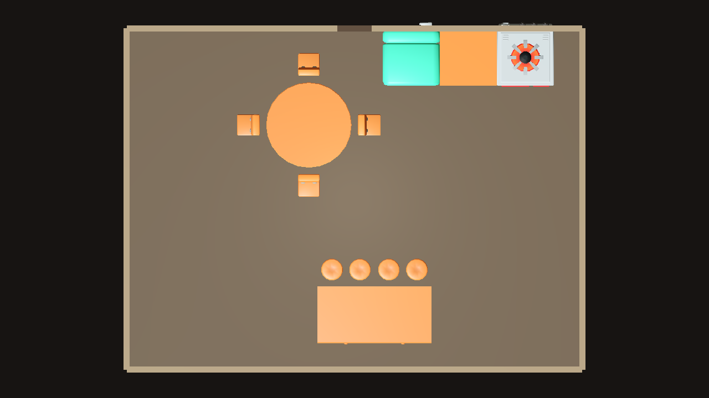
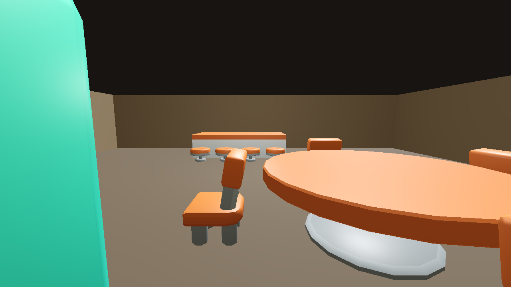
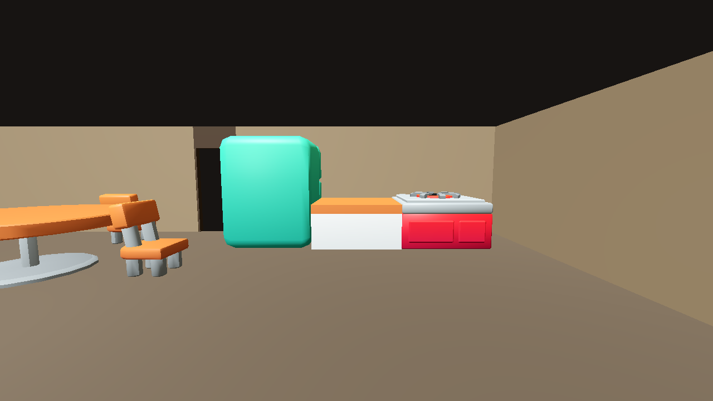
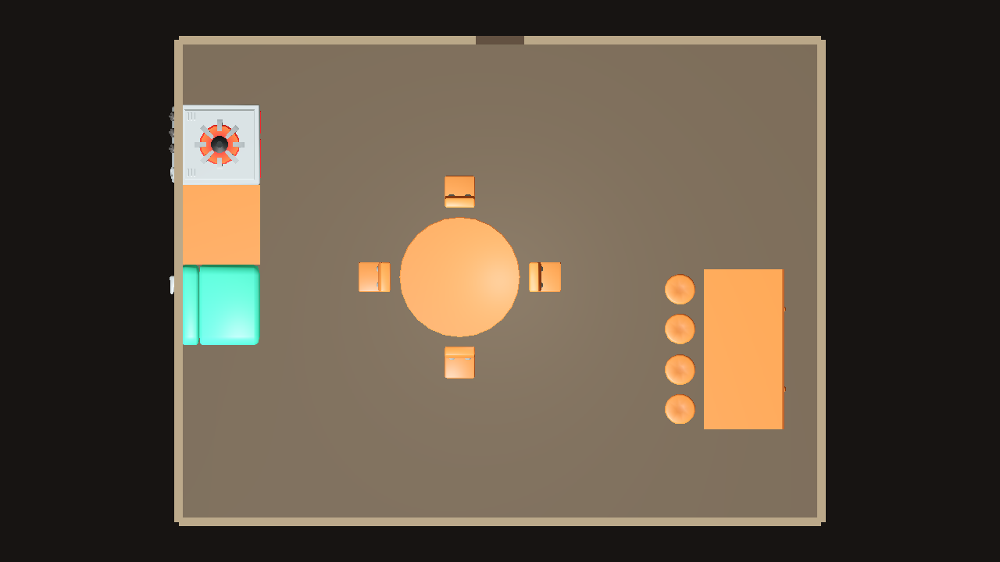
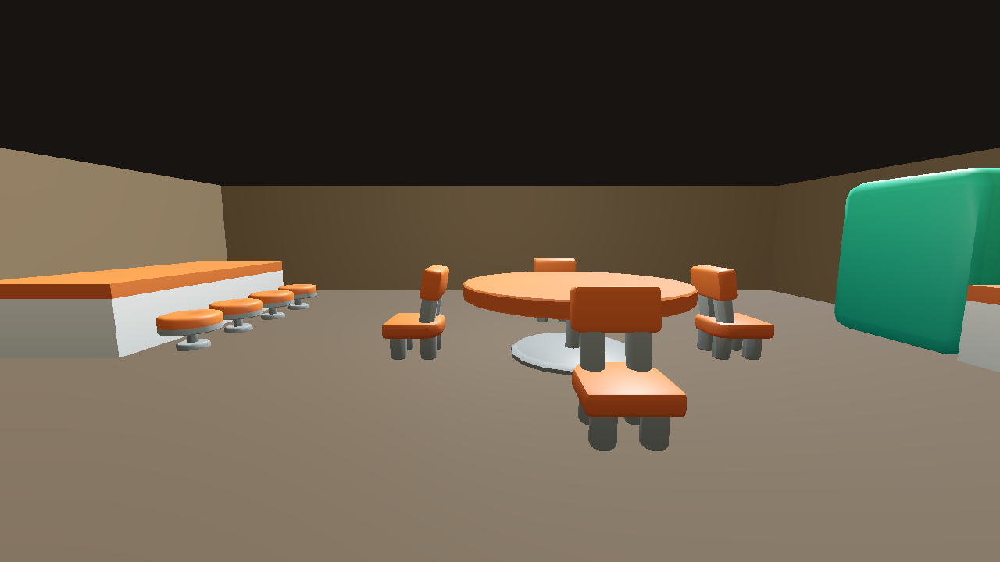
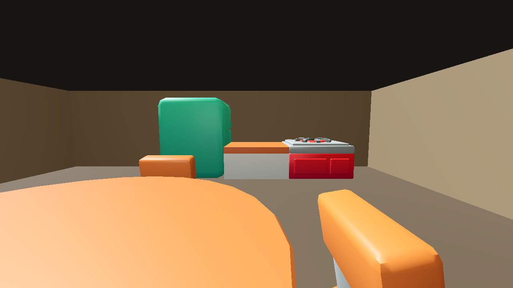

# FittingPlacer tavern experiment (LAY-01 / Issue #24, LAY-01B / Issue #28)

## LAY-01B result: PARTIAL for the tested two-seed layout gate

The unchanged pinned FittingPlacer solver produced all 14 requested pieces for seeds 4242 and 8675309 from the same XML rules. The kitchen topology is a counter with distinct left and right support faces; the stove RIGHT and refrigerator LEFT faces attach independently to those sides. Godot confirms both working fronts face the same side of the contiguous row. The bar sections keep a 0.9 m physical gap from the wall they attach to and reserve the same 0.9 m behind them.

Godot 4.7.1 renders the actual KayKit glTF assets at the solver-exported transforms. Top-down, south-entrance, and kitchen eye-level captures are included for each seed below. The entrance composition remains weak: seed 4242 puts the kitchen beside the south entry; seed 8675309 puts it against the west wall. The fridge occupies a large part of the entrance view. FittingPlacer's XML wall relation selects a generic room wall and cannot target a wall opposite the entrance or define a no-furniture entrance sightline. The 1.2 m door opening itself remains free, but reasonable visual composition is not guaranteed. This gate is therefore **PARTIAL**, not GO.

### Seed 4242





### Seed 8675309





### Encoded relationships and limitations

- **Encoded:** bar sections join end-to-end; the bar back face is 0.9 m from a room wall; a 0.9 m back clearance reserves the staff aisle; stools attach to the customer face.
- **Encoded:** the counter's left and right faces have distinct support types; the stove RIGHT and fridge LEFT faces each attach to one side. Each appliance retains a 0.8 m front clearance.
- **Encoded:** the kitchen counter is attached to a generic room wall to test whether a wall anchor improves the entrance composition. The solver may select any wall.
- **Encoded:** four chairs attach to four table edges and face inward; the south door opening remains reserved.
- **Observed in Godot:** both kitchen appliance fronts face the same accessible side of the shared row; the bar wall gap, customer stools and dining arrangement remain coherent in both layouts.
- **Not achieved:** an entrance composition clear of the kitchen/fridge in both seeds. Generic wall attachment does not constrain the kitchen to a particular wall or zone; seed 4242 places it along the south entry side.
- **Not guaranteed:** global route connectivity or navigation; no pathfinder or runtime character movement test is included.

### PASS / FAIL / NOT_TESTED

- **PASS** — unchanged pinned upstream solver generated 14/14 placements for seeds 4242 and 8675309 using identical XML semantics.
- **PASS** — exported bar footprint leaves exactly 0.9 m between its back edge and west wall; its 0.9 m clearance strip reserves that usable space.
- **PASS (visual)** — both Godot layouts show the contiguous stove-counter-fridge row with appliance fronts facing the same accessible aisle, customer-side stools, and the intact round table with four inward-facing chairs.
- **PARTIAL** — entrance opening is physically unoccupied, but entrance composition is poor for both seeds; FittingPlacer cannot target a particular wall or reserve an entrance sightline using this XML model.
- **PASS** — six new Godot 4.7.1 captures (top-down, entrance, kitchen eye-level per seed).
- **NOT_TESTED** — runtime walkability/path connectivity; the isolated preview has no player controller.

## What the solver computes

The test uses FittingPlacer commit `1cdb703197b41d418e7ce686e74c7aad835ddb37`, a C# implementation dual-licensed MIT/CC0. Its original projects target .NET Framework 4.6, which was unavailable here. `runner/Runner.csproj` compiles the upstream `Main/*.cs` source files unchanged against the available .NET 9 runtime; no solver logic is reimplemented.

FittingPlacer loads model sizes, four typed faces, pairwise face relations, clearances, room/door dimensions and an input list of model IDs from the XML. It selects at most **one furniture relation per fitting** and a separate wall relation where authored. Related placements become a group. It searches a discretized room grid for valid positions and quarter-turn rotations while checking overlaps and authored clearance areas. A zero-distance face relation joins touching edges; a positive distance sets a gap. The fixed seed makes this experiment repeatable.

Input authoring affected the outcome as expected: the first run attached the second bar segment by its right end, so FittingPlacer correctly joined the segments but their customer faces pointed in opposite directions. I changed that model's authored join face to its left end and reran the same seed. The resulting sections share orientation and all four stools occupy the same customer side. No placement coordinates or seeds were manually adjusted or searched.

It does not infer relationships from KayKit meshes, choose tavern zones, identify the customer side, or validate global routes. Those semantics and dimensions are authored explicitly in `tavern.xml`. The south door's local opening clearance is considered, and clearances are authored behind the dining chairs and stools and in front of the kitchen appliances. There is no pathfinder or route-connectivity check.

## Authored relationships and generated result

| Group | Authored relationship | Generated result |
| --- | --- | --- |
| Bar | Section A right end attaches to section B left end at 0 m; A's back attaches 0.9 m from a wall; both sections have a distinct front/customer face and 0.9 m back clearance. | Both counter sections form one 4 m run parallel to the selected wall, with a physical 0.9 m staff aisle. All four stools attach to the customer face. |
| Dining | Each chair's front face attaches 0.25 m from one of the round table's four typed edges. Chair width and side clearance limit the support edge capacity. | Four chairs, one on each side of the table, facing inward. |
| Kitchen | Stove right face attaches to the counter's left support face; fridge left face attaches to its distinct right support face, both at 0 m. Each work front reserves 0.8 m clearance. Counter back also has a generic wall relation. | Stove, counter and refrigerator form a contiguous row for both seeds; Godot captures show appliance fronts on the same working side. The generic wall relation selects different walls across seeds. |
| Entrance | South door center `(0, -6)`, width `1.2 m`, inward normal `+Y`; the solver reserves its immediate opening area. | The doorway footprint itself is unoccupied, but the fridge dominates the initial eye-level view in both seeds; a generic wall relation cannot keep the kitchen away from the south entrance zone. |

The JSON records each output as an `assetId`, `assetPath`, `translation` and `rotation`, plus the original solver X/Y/orientation for traceability. Godot maps solver `(x, y)` to world `(x, 0, z)` and maps the solver's positive quarter-turn to Godot's negative Y rotation. The loader does not move or rotate placements after reading JSON. Camera positions and static room shell geometry are preview-only.

## KayKit dimensions and license

The models come from KayKit Restaurant Bits 1.0 at pinned commit [`153c8a7535b48237854cb54ff6890679f8c574d1`](https://github.com/KayKit-Game-Assets/KayKit-Restaurant-Bits-1.0/tree/153c8a7535b48237854cb54ff6890679f8c574d1), whose included license is CC0. The source and license are already recorded in [`docs/assets_provenance.md`](../../../docs/assets_provenance.md); the experiment includes only the selected glTF/bin pairs, their shared atlas and license. No new external assets or license were introduced.

Dimensions below are the model bounds in meters, X × Y(height) × Z, read from the glTF positions; the refrigerator bounds include its translated door meshes. FittingPlacer expects floor-plane width/depth, so the XML uses X and Z extents.

| Model | Measured bounds | Solver footprint (width × depth) |
| --- | --- | --- |
| `table_round_A` | 3 × 1 × 3 | 3 × 3 |
| `chair_A` | 0.75 × 1.208 × 0.796 | 0.75 × 0.797 |
| `chair_stool` | 0.75 × 0.5 × 0.75 | 0.75 × 0.75 |
| `kitchencounter_straight_A` | 2 × 1 × 2.042 | 2 × 2.042 |
| `stove_single` | 2 × 1.208 × 2.288 | 2 × 2.288 |
| `fridge_A` | 2 × 2.5 × 2.24 | 2 × 2.24 |

KayKit's available stool seat is 0.5 m high while the counter top is 1.0 m high. The experiment preserves both measured model scales, so the generated stools read lower than a conventional bar stool in the close view. The solver provides the requested side relationship, but it does not fix this asset proportion mismatch.

## Reproduce

Requirements: PowerShell, Git, .NET 9 SDK, and Godot 4.7.1 console executable. From the repository root:

```powershell
powershell -ExecutionPolicy Bypass -File experiments/layout_solvers/fittingplacer/capture.ps1
```

The script obtains the pinned upstream solver into ignored `.local/FittingPlacer` if needed, runs seeds `4242` and `8675309` with the same XML, and saves top-down, entrance and kitchen eye-level captures for both. It leaves `layout.json` at seed `4242`. Pass `-GodotExe C:\path\to\Godot_v4.7.1-stable_win64_console.exe` if the engine executable is not on `PATH`; pass `-Seeds 4242,8675309` to select the default pair explicitly. Raw solver source, build output, Godot user data and caches stay in ignored `.local/` / `.godot/`; the authored XML, runner, seed-4242 JSON, KayKit subset and screenshots are committed here.

Godot's scene launch imports assets as needed; all six real OpenGL compatibility captures completed successfully.

## LAY-01 historical verification (Issue #24)

- **PASS** — Upstream solver source compiled unchanged and returned 14/14 placements in the 16 × 12 m room for seeds 4242 and 8675309.
- **PASS** — Actual KayKit furniture rendered from each generated JSON in Godot 4.7.1; top-down, entrance and kitchen eye-level screenshots captured for both seeds.
- **PASS (visual only)** — The generated entrance aisle appears open in the screenshots. There is no pathfinding or reachability guarantee.
- **PASS** — Bar side orientation, dining-chair facing, kitchen order and the relationships above are computed by FittingPlacer rather than hard-coded transforms.
- **NOT_TESTED** — Runtime character movement through the aisle, because the preview has no player/controller.
- No live game systems or PR #16/#22 files were changed.

**Historical conclusion:** FittingPlacer expressed the original relative furniture groups for seed 4242. LAY-01B's additional kitchen-front and entrance-composition findings are recorded above; this standalone preview does not provide a global navigation guarantee.

Closes #24 (original LAY-01 proof; LAY-01B is tracked by Issue #28)
