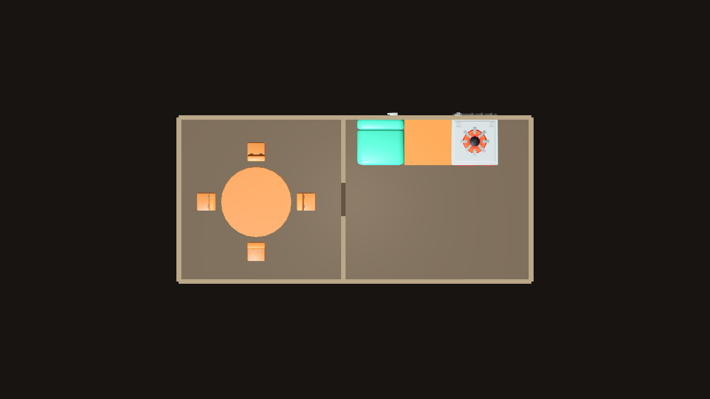
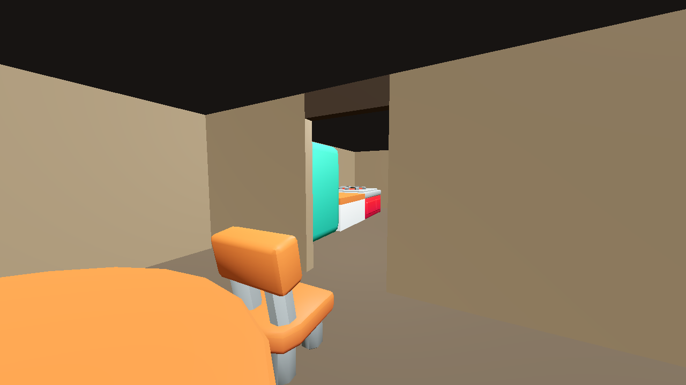

# LAY-04 — Stage 1 two-room checkpoint (PARTIAL)

This checkpoint proves only two adjacent physical rooms: a public hall with one round dining table and four inward-facing chairs, and a separate kitchen with the existing counter/stove/fridge group. It is not the complete tavern and does not close Issue #30.

## Brief and planner

`godot_preview/stage1_brief.json` declares the room types, furniture counts, adjacency, and seed. It contains no dimensions or world positions. The small planner in `runner/Program.cs` uses measured KayKit footprints recorded in `README.md`: it sizes the hall from `max(7 m, tables × 4.8 m + 2 m clearance)`. The kitchen is 8 × 7 m for the measured 6 m counter/stove/fridge run plus end clearance, a 0.8 m working front, and circulation. The side-by-side origins are derived from those dimensions. A 1.4 m opening is centered in the shared partition.

FittingPlacer is called independently for each rectangle with its existing pinned `tavern.xml` semantics and the same deterministic seed. Its local placement results are translated only by the derived room origins. No FittingPlacer source or per-item placement coordinates are changed.

## Run

Requirements: .NET 9 and Godot 4.7.1 console executable on `PATH`.

```powershell
powershell -ExecutionPolicy Bypass -File experiments/layout_solvers/fittingplacer/generate_stage1.ps1
```

The script generates `stage1_layout.json` and captures the isolated preview. Build output and Godot user data remain in ignored `.local/` / `.godot/` folders.

## Evidence

- **PASS** — Existing `generate.ps1 -Seed 4242` retains its original XML/JSON/seed CLI and generated 14/14 placements.
- **PASS** — FittingPlacer generated `hall requested=5 placed=5` and `kitchen requested=3 placed=3`, seed 4242.
- **PASS** — both generator scripts verify the local upstream `HEAD` against `1cdb703197b41d418e7ce686e74c7aad835ddb37`; Stage 1 only fetches/checks out that commit when needed.
- **PASS** — the isolated Godot 4.7.1 scene rendered the generated pieces from the KayKit glTF assets and the partition has an open 1.4 m doorway.
- **PASS (visual checkpoint)** — top-down shows the two rooms, shared wall opening, dining group and kitchen work line. The eye-level doorway view is taken from the hall, shows the dining chair beside the viewer, the open partition, and kitchen furniture beyond it.
- **NOT_TESTED** — runtime walkability/collision, route validation, variation briefs, and complete-tavern requirements. These are deferred from Stage 1 by the scope correction.
- **Known limitation** — the public hall sizing formula is currently specialized to the Stage 1 one-table brief; requests with other table counts are explicitly rejected. Kitchen sizing is a measured fixed allowance for this appliance set.




