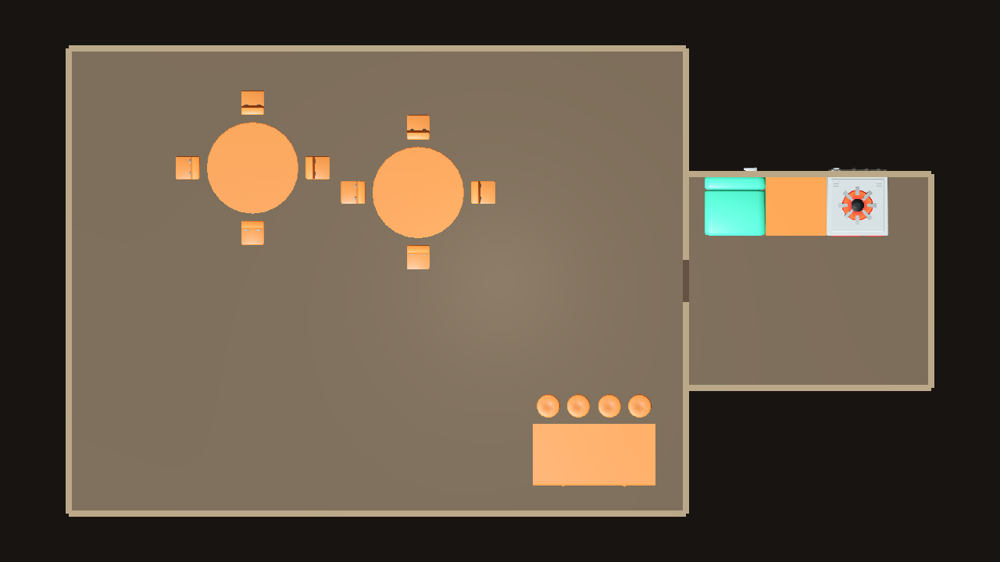
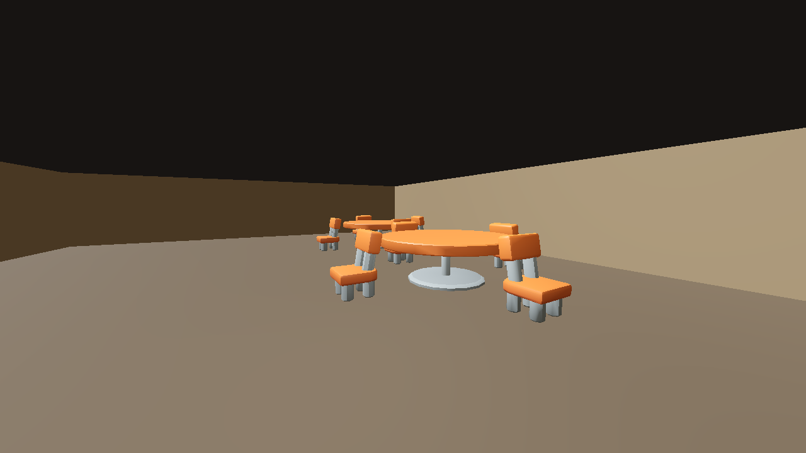
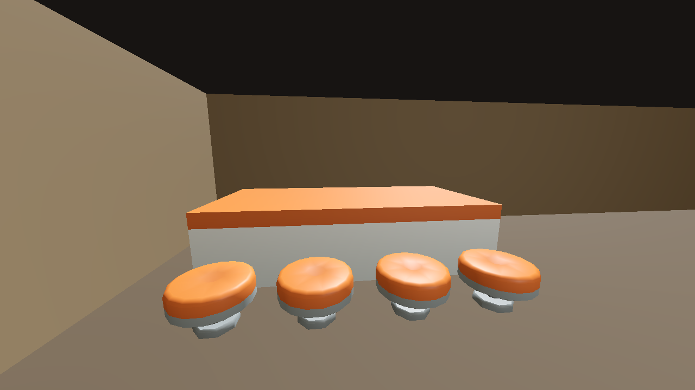
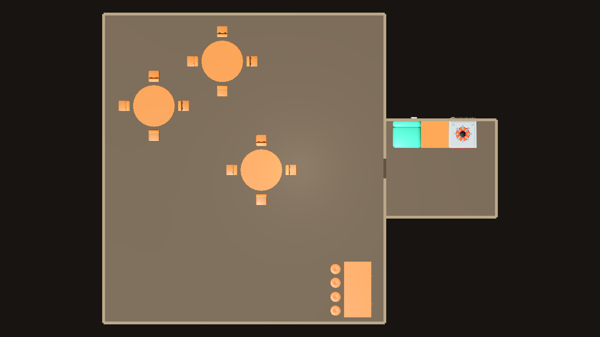
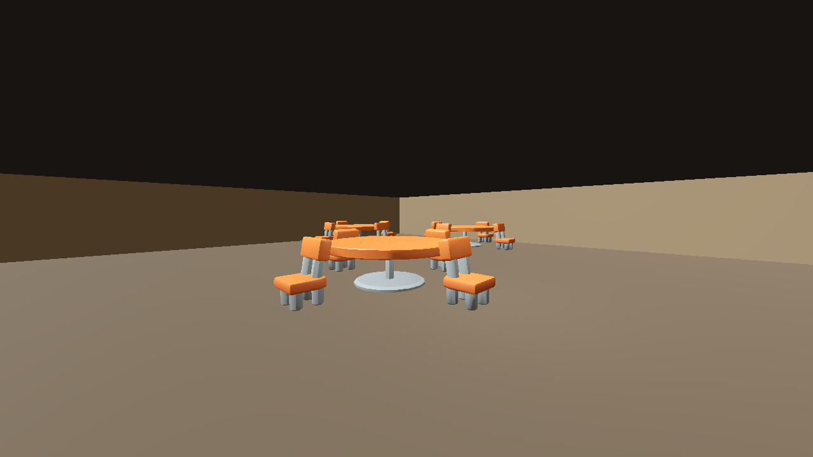
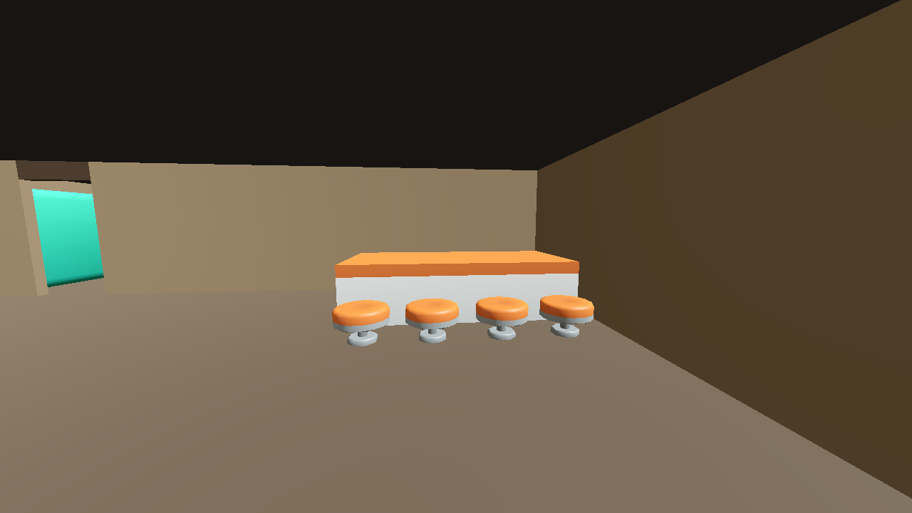
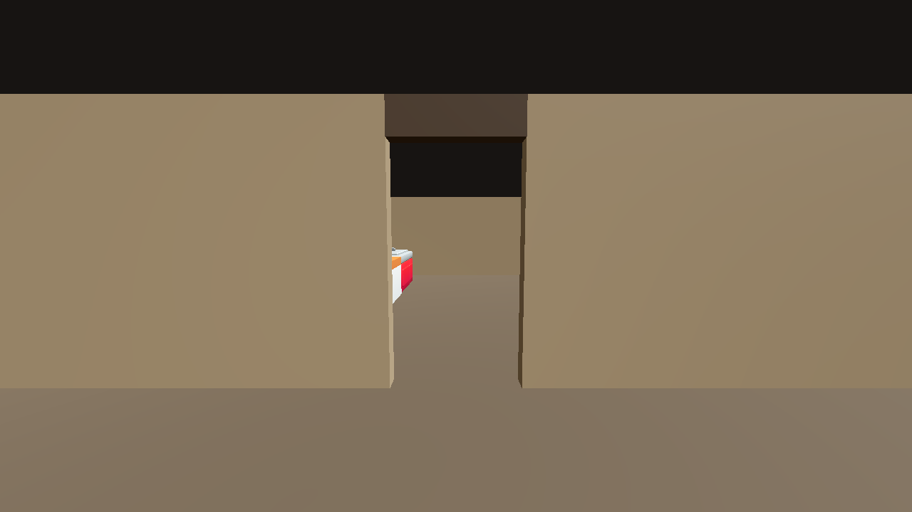

# LAY-04 — Stage 2 open functional zones (PARTIAL)

Stage 2 extends the merged Stage 1 two-room generator. It generates one public hall with open dining and bar regions and a separate adjacent kitchen. The regions have no internal walls. It does not implement the lounge, storeroom, entrance, or global route validation required by Issue #30, so this remains a **PARTIAL** checkpoint and the issue stays open.

## Briefs and dimensioning

`godot_preview/stage2-A-brief.json` requests two tables; `stage2-B-brief.json` requests three. Both request four chairs per table, two bar counter sections, four stools, and a separate kitchen with counter, stove, and refrigerator. The files contain quantities, zone types, and hall/kitchen adjacency, but no room dimensions or furniture world coordinates.

The planner in `runner/Program.cs` derives the dining grid from table count using the measured 3 m table and 0.75 × 0.797 m chair footprints, with a 7 m table pitch and 0.5 m zone margins. The bar footprint uses the measured 2 × 2.0419 m counter sections, four 0.75 m stools, 0.9 m wall-side staff aisle, 0.75 m clearance at the back of stools, 0.2 m counter-to-stool clearance, 0.9 m end margins, and 1.2 m open circulation between the logical regions. Kitchen width/depth are derived from the existing 2 m appliance run and measured deepest appliance footprint plus work-front/circulation allowances.

Dining, bar, and kitchen each make an independent call to the existing pinned FittingPlacer. For the bar call, the solver receives the full physical hall dimensions and actual hall perimeter walls; the east wall is represented as two real segments around the kitchen door. An occupancy mask excludes the rest of the hall from bar placement without turning logical zone edges into fake walls. The generated local placements are translated into the combined preview coordinates. No FittingPlacer internals were modified.

## Reproduce

Requirements: PowerShell, Git, .NET 9, and Godot 4.7.1 console executable on `PATH`.

```powershell
powershell -ExecutionPolicy Bypass -File experiments/layout_solvers/fittingplacer/generate_stage2.ps1 -Variant A
powershell -ExecutionPolicy Bypass -File experiments/layout_solvers/fittingplacer/generate_stage2.ps1 -Variant B
```

The script verifies `.local/FittingPlacer` is exactly `1cdb703197b41d418e7ce686e74c7aad835ddb37`, generates each JSON layout from its brief, imports the isolated preview, and captures top-down, dining, bar, and hall-to-kitchen doorway views. The doorway camera is derived from the hall/kitchen boundary and aims through the center of the shared opening from the hall side. The generated layouts are committed as `stage2-A-layout.json` and `stage2-B-layout.json` so the captured evidence can be inspected against actual transforms.

## Verification

- **PASS — Variant A:** FittingPlacer placed dining 10/10 (two tables, eight chairs), bar 6/6 (two sections, four stools), and kitchen 3/3. Validation reported `tables=2 chairs=8 ... staff_clearance=0.900m kitchen_doorway=clear chair_facing=ok stool_facing=ok`; bar attaches to the actual north hall wall.
- **PASS — Variant B:** FittingPlacer placed dining 15/15 (three tables, twelve chairs), bar 6/6, and kitchen 3/3. Validation reported `tables=3 chairs=12 ... staff_clearance=0.900m kitchen_doorway=clear chair_facing=ok stool_facing=ok`; bar attaches to the actual east hall wall above the doorway opening.
- **PASS — Counter orientation validation:** sections are compared by the cosine of their yaw delta, so same-facing sections pass modulo 2π while a 180° opposing facing yields cos(π) = -1 and fails the 0.99 threshold. Both generated variants pass the corrected check.
- **PASS — Change quantities in the JSON only:** the same command and planner generated both layouts; no layout coordinates were edited.
- **PASS — Existing commands retained:** `generate.ps1 -Seed 4242` returned 14/14; `generate_stage1.ps1` returned hall 5/5 and kitchen 3/3. The runner still supports its original XML/JSON/seed arguments and the Stage 1 `--stage1` mode.
- **PASS — Rendered assets and doorway evidence:** Godot 4.7.1 captured both configurations using the actual KayKit glTF assets in the isolated preview. Top-down and first-person screenshots were visually inspected. The added hall-to-kitchen views are taken inside the hall, show the actual open partition, and frame kitchen assets beyond it. The floor plan shows unpartitioned dining/bar regions and a separate kitchen.
- **NOT_TESTED — Full walkability:** checks verify furniture AABBs do not intrude into the kitchen-door approach and validate local table/stool facing. The isolated preview has no collision-backed player controller, pathfinder, lounge, storeroom, or entrance route; it does not claim global route connectivity.

### Variant A — two dining tables






### Variant B — three dining tables






## Remaining Issue #30 work

This checkpoint only demonstrates dynamic sizing/count changes, open functional zones in the public hall, the bar/kitchen furniture groups, and the hall-to-kitchen doorway. Lounge sofas, storeroom and contents, entrance/sightline layout, and global walkable-route validation remain for later review. No playable game files or gameplay systems are changed.
