# LAY-04 — Stage 3 lounge and storeroom

## Assessment: PASS (documented storage-asset fallback)

Stage 3 extends the Stage 2 zoned generator in the isolated FittingPlacer experiment. The brief declares three physical rooms, their adjacency, and furniture counts without room coordinates. The planner derives the main hall, kitchen, and storeroom bounds from the requested counts, measured KayKit footprints, and clearance allowances. Dining, bar, lounge, kitchen, and storage each use an independent call to the unchanged FittingPlacer. Local placements are translated into the shared preview coordinates.

The lounge is a logical open region of the main hall. It adds no walls. The hall-to-kitchen and kitchen-to-storeroom boundaries are physical partitions with 1.4 m openings. The storage call reserves the doorway approach through FittingPlacer's existing occupancy grid. Door positions are selected/validated against the generated furniture.

The unchanged legacy and Stage 1/2 commands remain available. Legacy (14/14), Stage 1 (hall 5/5, kitchen 3/3), and Stage 2 A/B validation and captures were rerun successfully. No playable game files or FittingPlacer internals were changed.

## Briefs and results

The two briefs request the same three-table dining area, two-section bar/four stools, and existing kitchen fixtures. A requests two sofas and four storage objects; B changes only those values to three sofas and six storage objects. The same implementation and seed (`4242`) generated both layouts.

```powershell
powershell -ExecutionPolicy Bypass -File experiments/layout_solvers/fittingplacer/generate_stage3.ps1 -Variant A
powershell -ExecutionPolicy Bypass -File experiments/layout_solvers/fittingplacer/generate_stage3.ps1 -Variant B
```

### A — 2 sofas, 4 storage objects

- **PASS:** 3 tables, 12 chairs, 2 bar sections, 4 stools, kitchen counter/stove/fridge, 2 sofas, coffee table, and 4 storage cabinets generated.
- **PASS:** sofas face the coffee table; cabinet fronts face into the storeroom and have clear 0.9 m approaches.
- **PASS:** all three room bounds are positive; room openings are clear; placement AABBs do not overlap; bar staff clearance is 0.900 m.
- **PASS:** Godot 4.7.1 imported the preview assets and captured the views below. Screenshots were visually inspected.

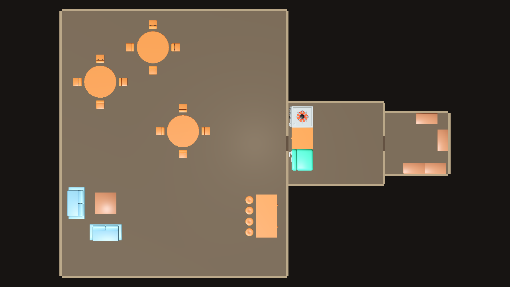
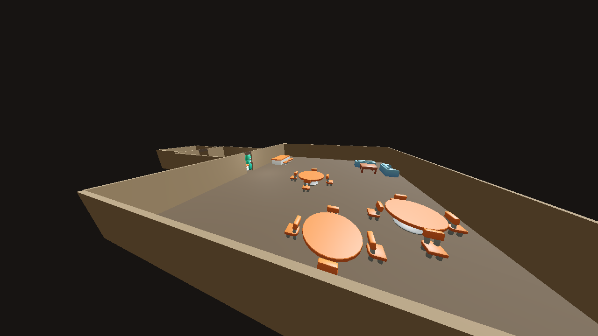
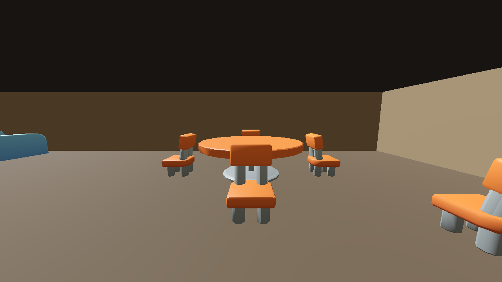
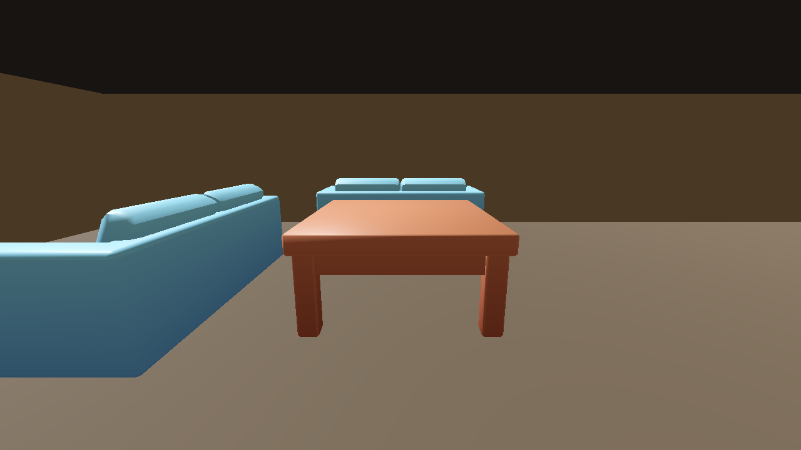
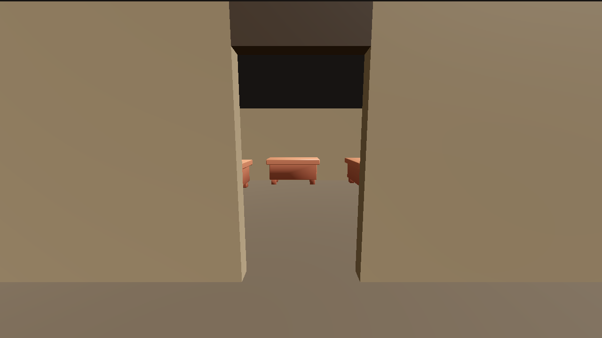
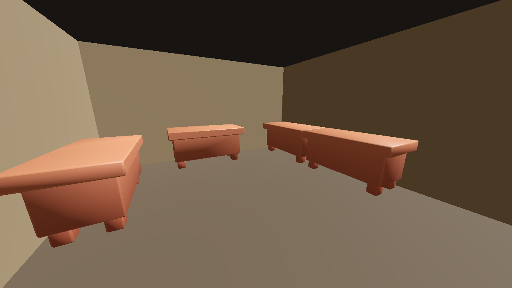

### B — 3 sofas, 6 storage objects

- **PASS:** 3 tables, 12 chairs, 2 bar sections, 4 stools, kitchen counter/stove/fridge, 3 sofas, coffee table, and 6 storage cabinets generated.
- **PASS:** sofas face the coffee table; cabinet fronts face into the storeroom and have clear 0.9 m approaches.
- **PASS:** all three room bounds are positive; room openings are clear; placement AABBs do not overlap; bar staff clearance is 0.900 m.
- **PASS:** Godot 4.7.1 imported the preview assets and captured the views below. Screenshots were visually inspected.

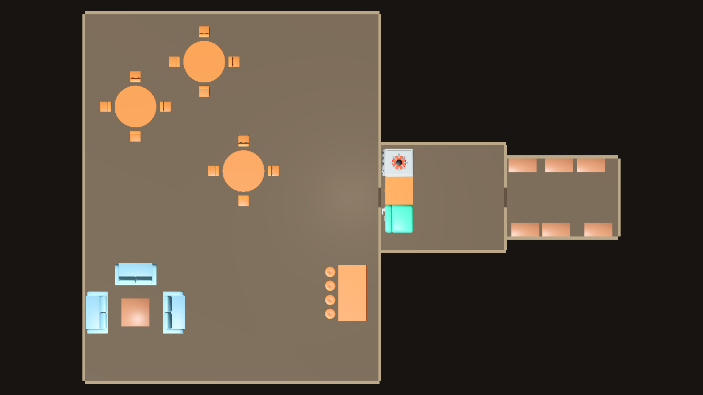
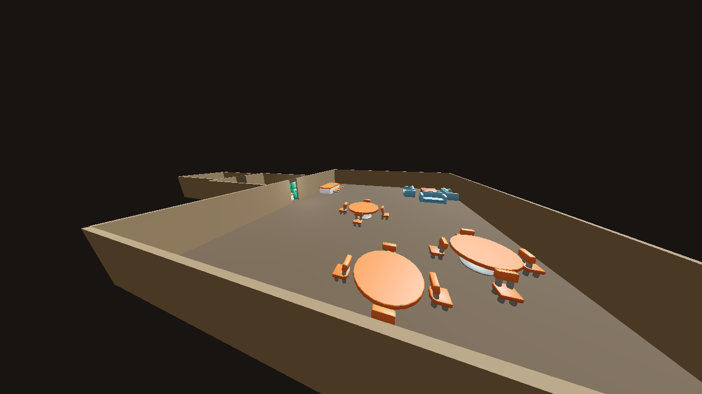
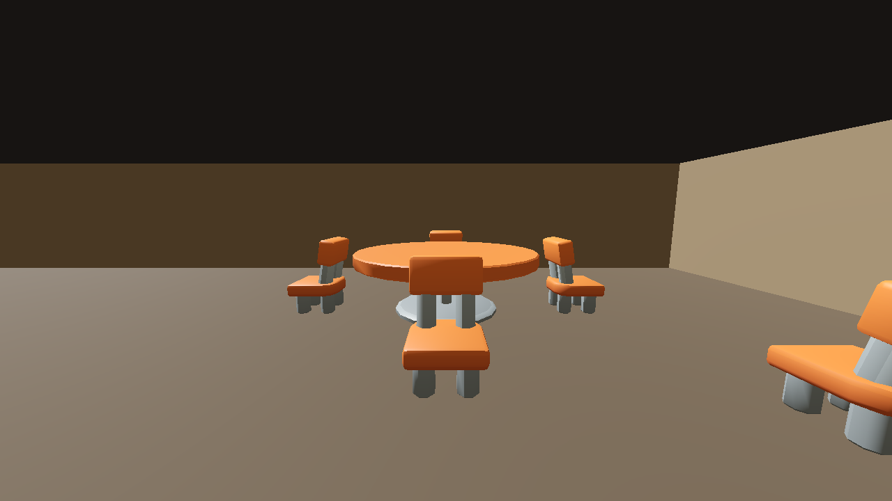
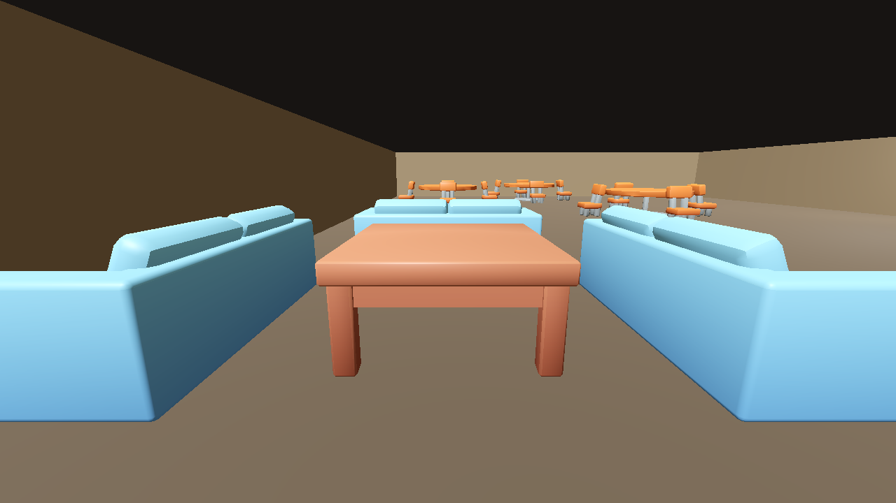
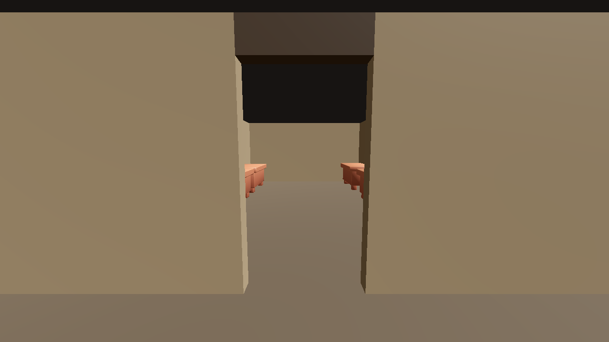
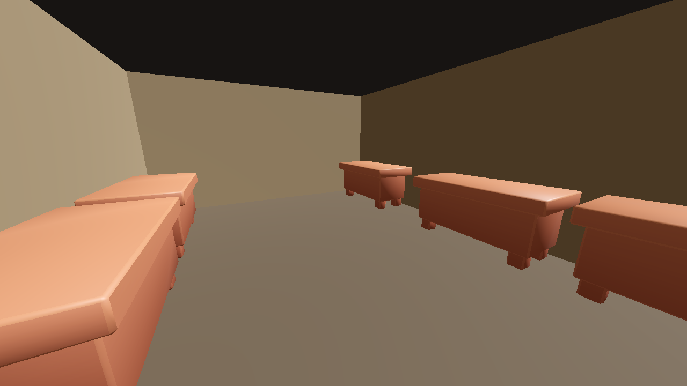

## Asset note

The available KayKit Furniture Bits catalog contains a couch, a medium table used as the coffee table, and a medium cabinet. The catalog contains no shelf, crate, or barrel model. Stage 3 therefore uses the existing cabinet model for each configurable generic storage object; this is a direct storage-use substitute and does not introduce unrelated props. The source pack is CC0; its license is included beside the isolated preview copies in `godot_preview/assets/FURNITURE_LICENSE.txt`.

## Verification limits

- **NOT_TESTED:** collision-backed walking, NPC navigation, and global flood-fill reachability. The isolated static preview has no player controller or pathfinder. Door threshold obstruction and storage-front clearance are checked from generated bounds.
- The camera renders physical partitions as static preview geometry; the proof does not add collision shapes or gameplay systems.
