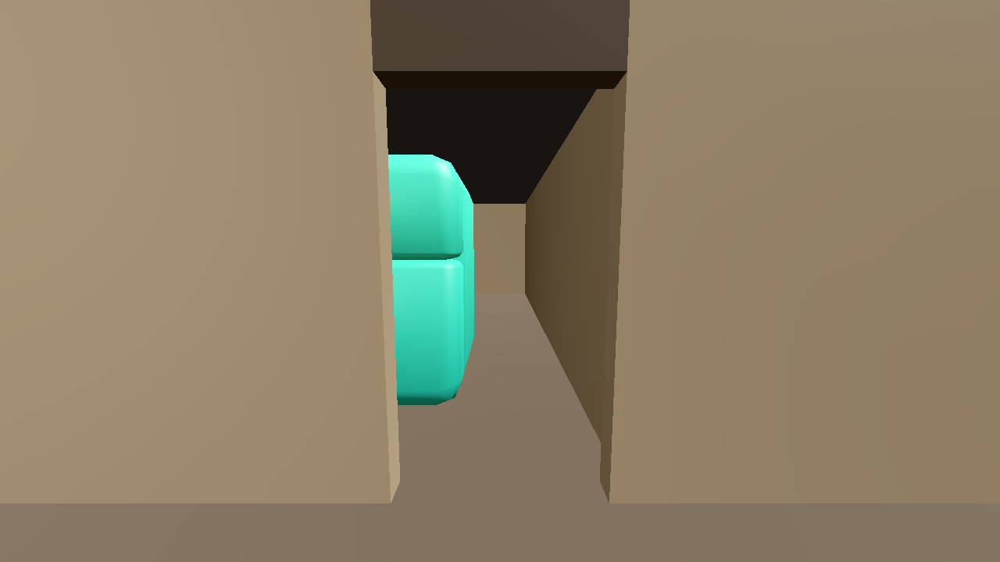
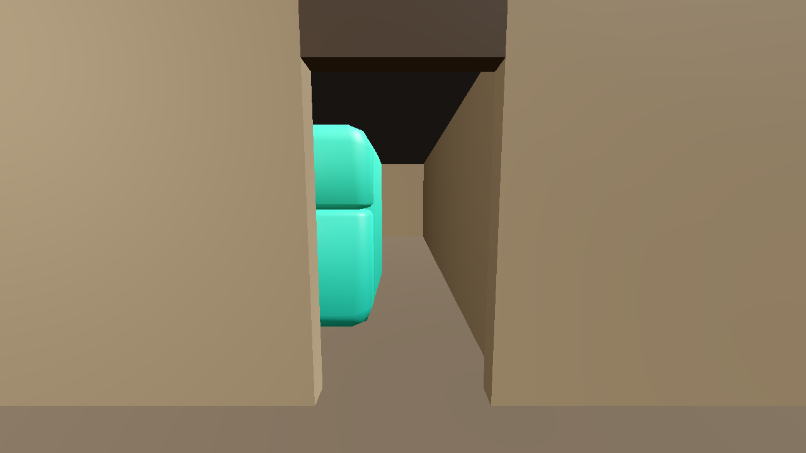

# LAY-04 — Stage 3 lounge and storeroom

## Assessment: PASS (kitchen corridor and connected work route verified)

Stage 3 extends the Stage 2 zoned generator in the isolated FittingPlacer experiment. The brief declares three physical rooms, their adjacency, and furniture counts without room coordinates. The planner derives the main hall, kitchen, and storeroom bounds from the requested counts, measured KayKit footprints, and clearance allowances. Dining, bar, lounge, kitchen, and storage each use an independent call to the unchanged FittingPlacer. Local placements are translated into the shared preview coordinates.

The lounge is a logical open region of the main hall. It adds no walls. The hall-to-kitchen and kitchen-to-storeroom boundaries are physical partitions with 1.4 m openings. The storage call reserves the doorway approach through FittingPlacer's existing occupancy grid. Door positions are selected/validated against the generated furniture.

The kitchen group receives one whole-group X translation after FittingPlacer generation. This preserves the counter/stove/fridge relationships while providing a measured 0.900 m entry corridor. The hall-to-kitchen door is selected automatically for maximum separation from the kitchen work line among clear candidates. A bounded 0.1 m grid check expands fixture bounds by a 0.4 m walking radius and verifies a connected path from the hall threshold, around the end of the fixture row, to the work side of the counter. The layout JSON records the corridor width and route result; this does not modify the FittingPlacer library or add a placement solver.

The unchanged legacy and Stage 1/2 commands remain available. Legacy (14/14), Stage 1 (hall 5/5, kitchen 3/3), and Stage 2 A/B validation and captures were rerun successfully. No playable game files or FittingPlacer internals were changed.

## Briefs and results

The two briefs request the same three-table dining area, two-section bar/four stools, and existing kitchen fixtures. A requests two sofas and four storage objects; B changes only those values to three sofas and six storage objects. The same implementation and seed (`4242`) generated both layouts.

```powershell
powershell -ExecutionPolicy Bypass -File experiments/layout_solvers/fittingplacer/generate_stage3.ps1 -Variant A
powershell -ExecutionPolicy Bypass -File experiments/layout_solvers/fittingplacer/generate_stage3.ps1 -Variant B
```

### A — 2 sofas, 4 storage objects

- **PASS:** 3 tables, 12 chairs, 2 bar sections, 4 stools, kitchen counter/stove/fridge, 2 sofas, coffee table, 2 cabinets, and 2 KayKit crates generated.
- **PASS:** sofas face the coffee table; cabinet and crate access sides face into the storeroom and have clear 0.9 m approaches.
- **PASS:** all three room bounds are positive; room openings are clear; placement AABBs do not overlap; bar staff clearance is 0.900 m; hall-to-kitchen entry corridor is 0.900 m and the route to the working side is connected.
- **PASS:** Godot 4.7.1 imported the preview assets and captured the views below. Screenshots were visually inspected.





### B — 3 sofas, 6 storage objects

- **PASS:** 3 tables, 12 chairs, 2 bar sections, 4 stools, kitchen counter/stove/fridge, 3 sofas, coffee table, 3 cabinets, and 3 KayKit crates generated.
- **PASS:** sofas face the coffee table; cabinet and crate access sides face into the storeroom and have clear 0.9 m approaches.
- **PASS:** all three room bounds are positive; room openings are clear; placement AABBs do not overlap; bar staff clearance is 0.900 m; hall-to-kitchen entry corridor is 0.900 m and the route to the working side is connected.
- **PASS:** Godot 4.7.1 imported the preview assets and captured the views below. Screenshots were visually inspected.





## Asset note

Review identified `crate.gltf` and `crate_potatoes.gltf` in the KayKit Restaurant Bits files already tracked by PR #16. Their source commit is `153c8a7535b48237854cb54ff6890679f8c574d1`; the PR's `docs/assets_provenance.md` records upstream paths, hashes, the pack's CC0 license, and the 2 x 2 x 0.8 m footprint. Only the two crate models, their shared pinned texture, and the existing license were copied into this isolated preview; PR #16 was not merged or otherwise changed. Both variants now combine crates with the KayKit Furniture Bits cabinet model. There are still no suitable shelf or barrel models in the checked inventory.

The coffee table uses `table_medium` because no lower lounge table model is present in the checked assets. Its measured height is 1.0 m, so it reads high and oversized beside the sofas; the screenshot documents that limitation rather than presenting it as a true low coffee table.

## Verification limits

- **NOT_TESTED:** collision-backed walking and NPC navigation. The isolated static preview has no player controller. Kitchen route connectivity is a static clearance-grid check using measured fixture bounds, not a runtime character traversal.
- The camera renders physical partitions as static preview geometry; the proof does not add collision shapes or gameplay systems.
