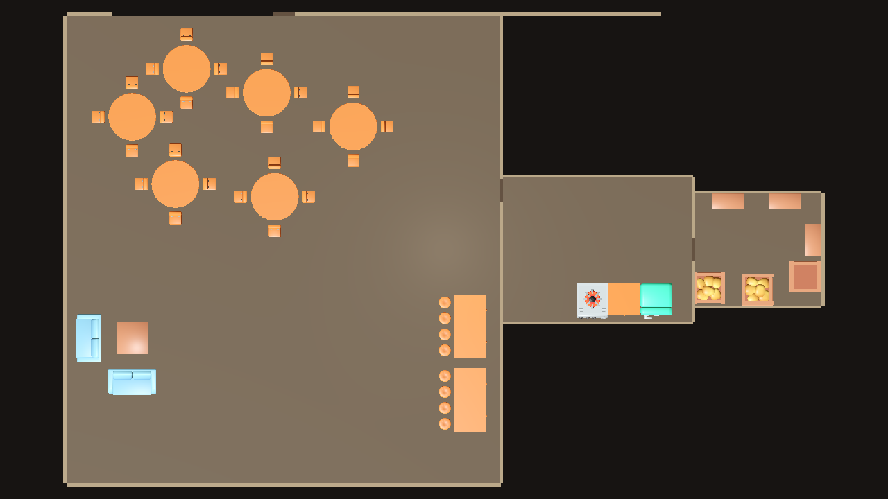
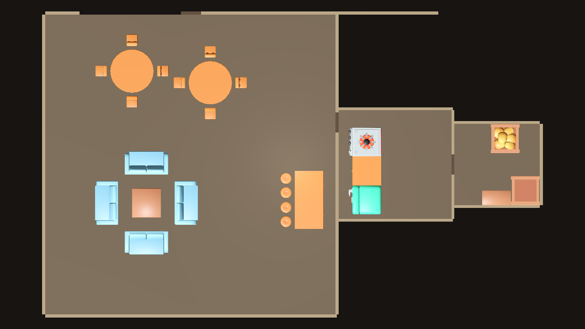

# LAY-05 — visual brief stress test

## Verdict: **PARTIAL**

With the same seed (`4242`), the Stage 3 zoning pipeline and unchanged FittingPlacer generated two clearly different Godot layouts from declarative briefs. Requested furniture counts match. Existing Stage 3 checks reported no furniture footprint overlaps, blocked room doors, or blocked kitchen approach. The 1.4 m public entrance is also generated from the placement bounds and is visible in the inward view.

The large brief's four counter sections form one long run overall, but FittingPlacer connects them as two joined pairs with a 0.6 m gap between pairs. The current relationship data has no way to chain all four sections into one continuous counter. The large kitchen also contains the same three fixtures as the compact kitchen, so its added floor area reads sparse. KayKit's available stool is 0.5 m high beside a 1 m counter; the lounge table is also 1 m high and oversized for a coffee table. These asset/relationship limitations keep the result at **PARTIAL**.

## Briefs and reproduction

- A verbal brief: spacious busy tavern, 6 tables with chairs, long bar, 2 sofas, generous kitchen, large separate mixed-prop storeroom.
- B verbal brief: compact lounge-oriented tavern, 2 tables with chairs, short bar, 4 sofas, compact kitchen, small separate storeroom.
- Machine-readable inputs: [A brief](godot_preview/stage5-A-brief.json), [B brief](godot_preview/stage5-B-brief.json).
- Generated outputs: [A layout](godot_preview/stage5-A-layout.json), [B layout](godot_preview/stage5-B-layout.json).
- Reproduction from the repository root (PowerShell, .NET 9, Godot 4.7.1):

```powershell
$godot = (Get-Command Godot_v4.7.1-stable_win64_console.exe).Source
./experiments/layout_solvers/fittingplacer/generate_stage5.ps1 -Variant A -GodotExe $godot
./experiments/layout_solvers/fittingplacer/generate_stage5.ps1 -Variant B -GodotExe $godot
```

The script fetches FittingPlacer into ignored `.local/FittingPlacer` when needed and checks out the pinned commit `1cdb703197b41d418e7ce686e74c7aad835ddb37`. It runs the existing Stage 3 entry point, imports the isolated Godot preview, and captures the seven views for each variant. No seed search or furniture-coordinate authoring is used.

## A/B comparison

| Generated measure | A — spacious/busy | B — compact/lounge |
| --- | ---: | ---: |
| Seed | 4242 | 4242 |
| Hall footprint | 27.14 × 29.20 m | 20.14 × 20.70 m |
| Kitchen footprint | 12 × 9 m (`generous`) | 8 × 7.49 m (`compact`) |
| Storeroom footprint | 8 × 7 m (`large`) | 6 × 5.6 m (`compact`) |
| Dining | 6 tables, 24 chairs | 2 tables, 8 chairs |
| Bar | 4 sections, 8 stools | 2 sections, 4 stools |
| Lounge | 2 sofas, 1 table | 4 sofas, 1 table |
| Storage | 6 mixed KayKit props | 3 mixed KayKit props |

**Observed in Godot:** A has a much larger hall, a longer bar and a broad six-table dining area. B has half the dining count and a four-sofa lounge that dominates the public hall. Both have separate kitchen and storeroom partitions with open doorways and a south public entrance. The same three kitchen fixtures appear in each; the larger A room is visibly roomier but under-furnished. The top views show clear separation between the variants, though both still have a lot of open floor because the dining, bar and lounge are arranged as open zones in one hall. In close views, A's dining camera is partly occluded by the nearest tabletop and B's lounge camera puts sofa backs close to the lens; the generated placements themselves are not shifted for those shots.

### Top-down and entrance views

| A | B |
| --- | --- |
|  |  |
| [A entrance looking inward](godot_preview/screenshots/stage5-A-entrance.png) | [B entrance looking inward](godot_preview/screenshots/stage5-B-entrance.png) |

### First-person evidence

| View | A | B |
| --- | --- | --- |
| Dining | [Screenshot](godot_preview/screenshots/stage5-A-hall_dining.png) | [Screenshot](godot_preview/screenshots/stage5-B-hall_dining.png) |
| Bar | [Screenshot](godot_preview/screenshots/stage5-A-hall_bar.png) | [Screenshot](godot_preview/screenshots/stage5-B-hall_bar.png) |
| Lounge | [Screenshot](godot_preview/screenshots/stage5-A-lounge.png) | [Screenshot](godot_preview/screenshots/stage5-B-lounge.png) |
| Kitchen | [Screenshot](godot_preview/screenshots/stage5-A-kitchen.png) | [Screenshot](godot_preview/screenshots/stage5-B-kitchen.png) |
| Storeroom | [Screenshot](godot_preview/screenshots/stage5-A-storeroom.png) | [Screenshot](godot_preview/screenshots/stage5-B-storeroom.png) |

## What the brief controls

**Computed from brief data:** table/chair counts; bar-section and stool counts; sofa count; storage-object count and KayKit mix; kitchen/storeroom capacity sizes; hall and subzone bounds; generated object transforms; and placement-aware entrance clearance. All furniture transforms come from FittingPlacer, with the existing whole-group fit translation into its derived zone.

**Still fixed:** the three-room `hall → kitchen → storeroom` topology; south-facing 1.4 m public entrance; 1.4 m internal door widths; four chairs per table; one lounge table; the kitchen counter/stove/fridge inventory; aisle clearances; and the KayKit model dimensions. Room size fields add floor area but do not add more kitchen fixtures.

## Verification

- **PASS** — A generated 30/30 dining pieces, 12/12 bar pieces, 3/3 kitchen fixtures, 3/3 lounge pieces and 6/6 storage props.
- **PASS** — B generated 10/10 dining pieces, 6/6 bar pieces, 3/3 kitchen fixtures, 5/5 lounge pieces and 3/3 storage props.
- **PASS** — Existing Stage 3 A/B briefs without room-size fields still generate with their original standard room capacities and unchanged commands.
- **PASS** — Existing Stage 3 count, overlap, room-door, storage-access and kitchen-entry checks passed for both; kitchen entry corridors measured 4.700 m (A) and 0.900 m (B).
- **PASS (visual)** — Godot 4.7.1 imported and rendered real KayKit assets for top-down, entrance, dining, bar, lounge, kitchen and storeroom views. All 14 screenshots were inspected.
- **NOTE** — Godot printed a safe-save warning during `--import`, but the import process returned success, completed its asset scan, and each scene capture launched and saved successfully.
- **NOT_TESTED** — Collision-backed player traversal; this experiment is a static isolated preview.

No playable game files, FittingPlacer source, Stage 4 BFS/diagnostics or PR #35 code were used or changed.
