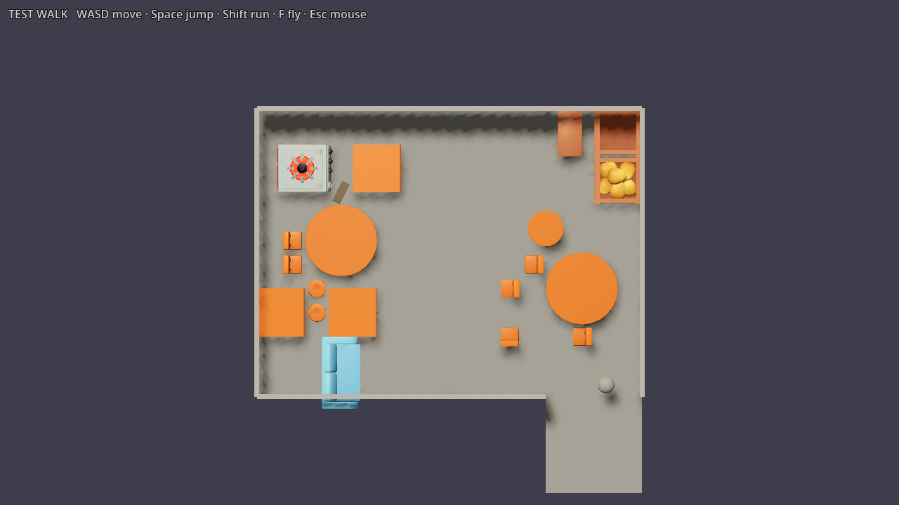
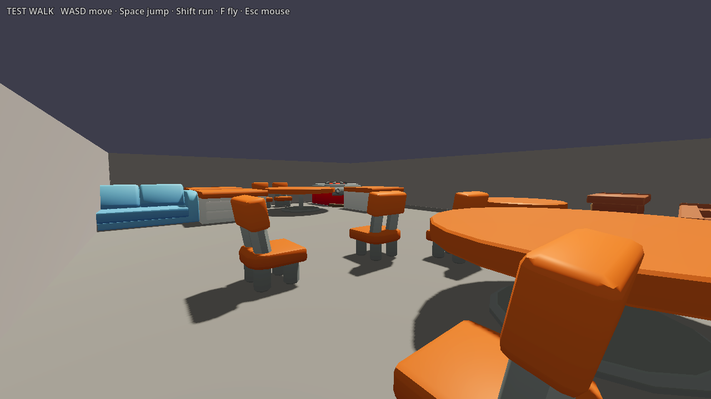
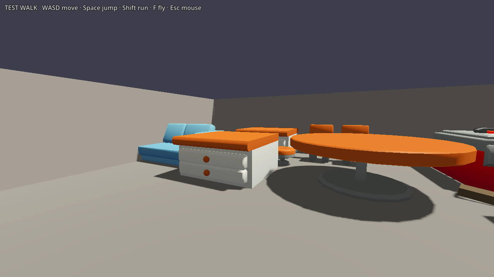
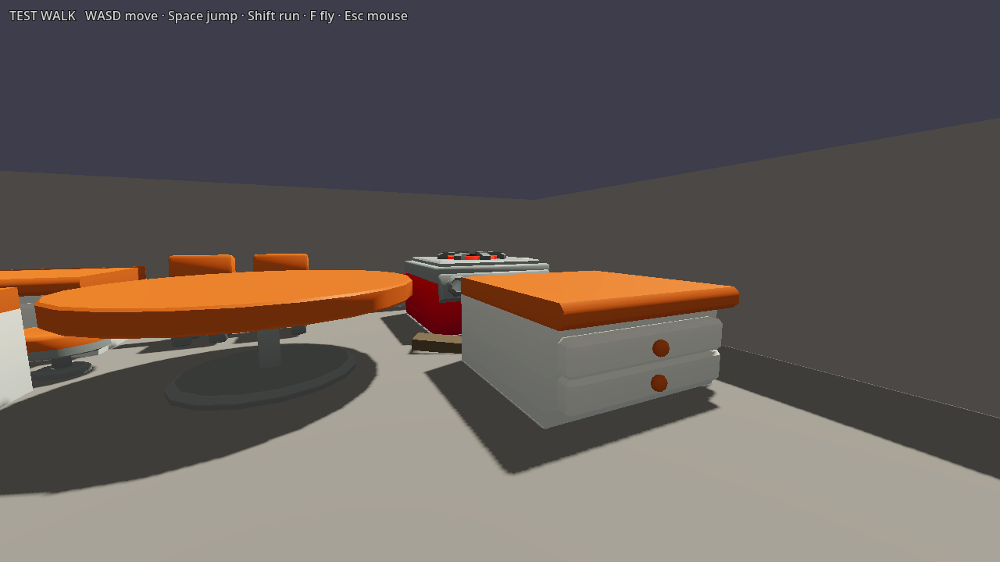
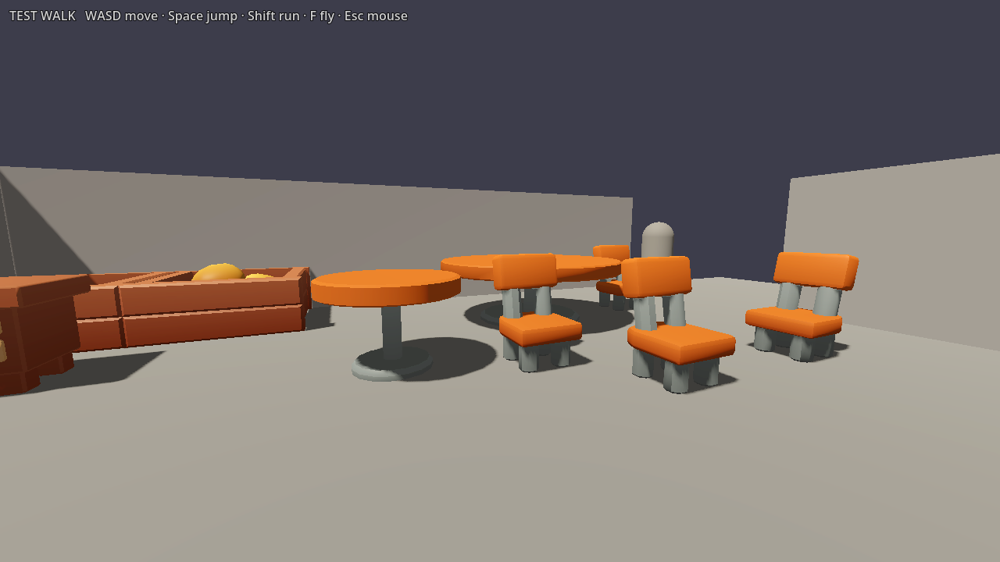

# Level Builder Lite — LBG-01

Isolated evaluation for Issue #18. The addon source is installed at `addons/level_builder/` on this experiment branch; its MIT license is retained at `addons/level_builder/LICENSE`.

The plugin remains disabled in `project.godot`; the project-wide plugin setting was left untouched. The actual stock generator and zone preview functions were invoked directly from the installed addon in Godot 4.7.1.

## Capability check

| Check | Result | Evidence |
| --- | --- | --- |
| Free package and requirements | PASS | Official [Lite page](https://selodev.itch.io/level-builder-lite-free-3d-room-generator-for-godot-4) currently offers v2.0.3, MIT, Godot 4.5+, pure GDScript, no GDExtension. The issue cited v2.0.0; this used the current free release. |
| Stock room presets | PASS | Bedroom, Shrine, and Smithy have `brief_room_*.tres` presets. The free package also contains Guardroom and Tavern `room_*.tres` archetypes, but no corresponding stock briefs. |
| Tavern meaning | PASS | Tavern is an authoring archetype (`room_tavern.tres`) with zone rules and bar/table groups. It is not a ready-to-generate Tavern preset. A brief plus content mapping is needed. |
| Zone overlay | PASS | Built from the generated Bedroom: `travel`, `entrance`, `center`, `work`, `storage`, `presentation`, and `clutter`. The overlay is an ownerless preview node and is intentionally omitted from the saved scene. |
| Seed reproducibility | PASS | Two actual generator runs with identical Bedroom settings and seed 4242 produced the same plan and prop placements. |
| Walkability smoke check | PASS | The bundled Test Walk player moved 3.75 m forward through the generated entry into the room in a 0.75 s headless physics run. Generator findings were empty. This is one room/seed, not a multi-seed collision audit. |
| Static scene output | PASS | `stock_bedroom.tscn` reopened after saving and runs without generator execution. Its shell and props are ordinary saved nodes/instances; the scene references only the addon’s greybox pieces and bundled Test Walk controller. |
| Existing KayKit assets | PASS, manual palette | The addon palette recognizes `.glb` and `.gltf`. Its scanner found all 10 current KayKit furniture/item files and Godot loaded all 10 as `PackedScene`. The Assets tab is manual click-to-place. Generator placement additionally needs data resources (`prop_*.tres`, tags, footprints, and group rules); this is configuration work, not custom generator code. |
| Pro / extensions | PASS | No Pro files or GDExtension are used. Only the publisher's `addons/level_builder/` was copied; bundled demo scenes and binaries were excluded. |

## Run it

From the repository root with Godot 4.7.1:

```powershell
Godot_v4.7.1-stable_win64_console.exe --headless --path . --script res://experiments/level_builder_lite/generate_stock_room.gd
Godot_v4.7.1-stable_win64_console.exe --path . --scene res://experiments/level_builder_lite/stock_bedroom.tscn
Godot_v4.7.1-stable_win64_console.exe --path . --scene res://experiments/level_builder_lite/zone_preview.tscn
```

The stock scene has the addon's Test Walk controller: WASD moves, Space jumps, Shift runs, F toggles flight, and Esc toggles mouse capture. The zone preview scene rebuilds the temporary overlay for viewing; it does not modify the stock scene.

## Evidence

Top-down zone overlay:


First-person view:


## Verdict

**GO to LBG-02 as a separately authorized experiment.** The Lite generator, zone logic, seed behavior, and static output work in Godot 4.7.1. KayKit models load directly in the manual palette; using them in generated groups needs a small data-mapping pass. Expect to author prop semantics and room/group configuration. Do not expect automatic KayKit recognition or a ready Tavern preset.

The screenshots are from command-line movie capture. The Godot editor dock UI was not verified in this run because the sandboxed editor could not write its user settings under `AppData/Roaming/Godot`.

The headless run exits with Godot 4.7.1 Dummy/GLES resource teardown warnings after the PASS output; the process exits 0 and reports no generation validation findings or scene script errors. The project editor also attempted to write `user://` data to an unavailable path in this sandbox. These environment limitations prevented verifying the dock itself through the editor UI.

---

# LBG-02 — KayKit Tavern generation (Issue #19)

## Result: PARTIAL

Testing the actual furniture from TAV-03 PR #16 changed the result. Level Builder Lite 2.0.3 generated recognizable furniture groups with its built-in room, zone, and activity-group algorithms. The selected seed has two connected counter sections with two stools, three round guest tables with two chairs each, a stove beside a kitchen counter, storage crates, and a sofa. No placement solver was written and no generated furniture transform was edited.

The target layout is only partly met. Seed 7001 put the kitchen in the northwest, the bar along the west wall, and storage in the northeast. The sofa landed in the southwest by the entrance, rather than in the northeast lounge area. The other seeds moved the functional zones, and seeds 4242 and 9183 produced only two table groups. A central route is visible in the selected top-down view, but the entrance-side route passes close to a guest table. The screenshots support human review; they do not turn the positional inconsistency into a pass. This demonstrates practical KayKit placement, with the layout consistency and lounge location limitations documented as PARTIAL.

## Assets and measured footprints

TAV-03 PR #16 was used only as the source for the following missing Restaurant Bits models. The PR was not merged or cherry-picked. The required glTF, binary buffers, texture, and import metadata are copied under this experiment. The source pack's `LICENSE.txt` is included beside them and is CC0. Provenance in TAV-03 identifies upstream `KayKit-Game-Assets/KayKit-Restaurant-Bits-1.0`, pinned commit `153c8a7535b48237854cb54ff6890679f8c574d1`; source paths and SHA-256 values are recorded in [PROVENANCE.md](assets/PROVENANCE.md). The existing Furniture Bits couch and cabinet and Restaurant Bits refrigerator remain referenced from the repository's already-installed KayKit assets.

Dimensions below come from each glTF's actual VEC3 accessor bounds (including its source pivot offsets) before assigning `PropSemantics.footprint`. Lite's solver grid is 1 m/cell, while its greybox shell modules are 4 m. Footprints use conservative whole solver cells, not shell modules.

| KayKit model | Measured bounds W×H×D (m) | Solver footprint (cells) | Pivot treatment |
| --- | ---: | ---: | --- |
| `table_round_A` | 3.00×1.00×3.00 | 3×3 | centered, floor at y=0 |
| `table_round_A_small` | 1.50×1.00×1.50 | 2×2 | centered, floor at y=0 |
| `chair_A` | 0.75×1.208×0.796 | 1×1 | source bottom ~0 |
| `chair_stool` | 0.75×0.50×0.75 | 1×1 | centered, floor at y=0 |
| `kitchencounter_straight_A` | 2.00×1.00×2.042 | 2×3 | wrapper recenters z by 0.021 m |
| `stove_single` | 2.00×1.208×2.288 | 2×3 | wrapper recenters z by 0.114 m |
| `crate` | 2.00×0.80×2.00 | 2×2 | source bottom ~0 |
| `crate_potatoes` | 2.00×0.966×2.00 | 2×2 | source bottom ~0 |

Other generated models have footprints from the same measurement pass: table_medium 2×1×2 m → 2×2 cells; cabinet_medium 2×1×1.002 m → 2×2; couch 3×1.224×1.6 m → 3×2; refrigerator 2×2.5×2.24 m → 2×3; bun 0.7×0.507×0.7 m → 1×1. The bun is not in the selected groups because the generator has no table-top placement mode.

`generation/` contains only data resources for semantics, activity groups, the Tavern archetype, and brief. `generate_tavern.gd` temporarily registers them in the installed Lite library, invokes its normal `generate()` and `apply()` paths, then removes those temporary files. The runner has no custom placement logic. The generated room root is reflected across Z and translated to place Lite's north entry on the south while retaining west/east assignments. Manually authored transforms are limited to the first-person test-player spawn and three NPC location markers.

## Seeds and evaluation

All three final runs used the 16×12 m Tavern brief, greybox shell, lived-in palette, and the command-line seed shown. They returned empty generator validation findings.

| Seed | Props | Tables / chairs | Bar counter / stools | Kitchen grouping | Storage | Lounge |
| --- | ---: | ---: | ---: | --- | --- | --- |
| 4242 | 18 | 2 / 4 | 2 / 2 | stove + counter + fridge, together | 2 crates in storage zone | sofa elsewhere |
| 7001 | 20 | 3 / 6 | 2 / 2 | stove + counter, together; fridge optional member did not fit | 2 crates in storage zone | sofa southwest |
| 9183 | 18 | 2 / 4 | 2 / 2 | stove + counter + fridge, together | 2 crates in storage zone | sofa elsewhere |

The seed 7001 room is saved as `kaykit_tavern.tscn`. The generator does not guarantee the room's named zones match the requested compass quadrants: its storage crates stay grouped and outside the central open area, but their location is northeast in seed 7001; the sofa is southwest. Table chairs are placed in each table's activity group and within a few metres, but the solver does not align chair rotations to exact table seating positions. The top-down screenshot shows an open central floor and a narrow aisle past the eastern table from the south entry; human play review is still needed for subjective comfort.

## Run in Godot (F6)

1. Open this project in Godot 4.7.1.
2. In the FileSystem dock, open `experiments/level_builder_lite/kaykit_tavern.tscn`.
3. Press **F6** to run the current scene. This launches the saved standalone seed 7001 scene; it does not change `scenes/main.tscn`.
4. Walk with WASD, jump with Space, run with Shift, toggle flight with F, and release/re-capture the mouse with Esc.

For a top-down editor-run view, open `kaykit_tavern_overview.tscn` and press F6. To regenerate any comparison seed from the repository root (after importing the project assets once):

```powershell
Godot_v4.7.1-stable_win64_console.exe --headless --editor --path . --script res://experiments/level_builder_lite/generate_tavern.gd -- 4242 res://.local/seed_4242.tscn
Godot_v4.7.1-stable_win64_console.exe --headless --editor --path . --script res://experiments/level_builder_lite/generate_tavern.gd -- 7001 res://.local/seed_7001.tscn
Godot_v4.7.1-stable_win64_console.exe --headless --editor --path . --script res://experiments/level_builder_lite/generate_tavern.gd -- 9183 res://.local/seed_9183.tscn
```

The committed screenshots were captured through Godot's existing movie-writer mode. The review camera scene changes only the camera view; furniture remains at the generated transforms.

## Visual evidence

Top-down layout, seed 7001:



First-person views:






## Checks and limitations

- **PASS:** required KayKit furniture imported from the PR #16 source only; glTF dimensions measured and footprints configured on the 1 m solver grid.
- **PASS:** three final seeds were generated with the built-in Level Builder Lite algorithms, and the selected result was saved as a static scene and launched with Godot movie capture.
- **PASS:** visible groups include bar counter sections with stools, guest tables with chairs, stove plus counter, and paired storage crates. The selected top-down view retains a broad central open route.
- **PARTIAL:** kitchen, storage, and lounge compass placement varies between seeds. In selected seed 7001 the kitchen is northwest and storage northeast, while the sofa is southwest rather than northeast. Seed 7001 has three table groups; the other two seeds have two.
- **NOT TESTED:** no automated collision or path framework was added. Empty generator findings do not establish collision clearance. Visual evidence shows chairs close to tables and the entrance aisle is narrow around the nearest table; review the static scene with F6.
- No gameplay, vocabulary, scenarios, save data, PR #16 files, Pro files, or addon generator code were changed.
