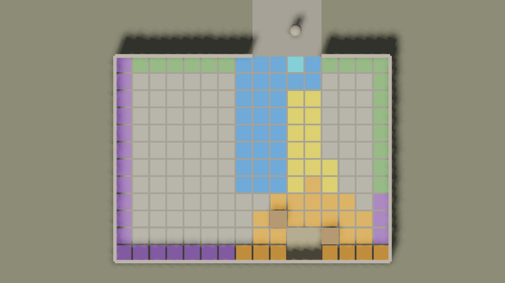
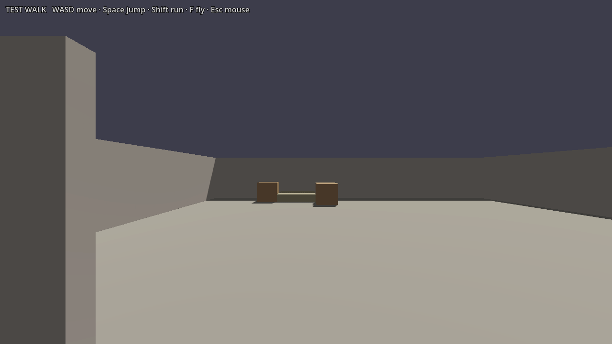

# Level Builder Lite — LBG-01

Isolated evaluation for Issue #18. The addon source is installed at `addons/level_builder/` on this experiment branch; its MIT license is retained at `addons/level_builder/LICENSE`.

The plugin remains disabled in `project.godot`; the project-wide plugin setting was left untouched. The actual stock generator and zone preview functions were invoked directly from the installed addon in Godot 4.7.1.

## Capability check

| Check | Result | Evidence |
| --- | --- | --- |
| Free package and requirements | PASS | Official [Lite page](https://selodev.itch.io/level-builder-lite-free-3d-room-generator-for-godot-4) currently offers v2.0.3, MIT, Godot 4.5+, pure GDScript, no GDExtension. The issue cited v2.0.0; this used the current free release. |
| Stock room presets | PASS | Bedroom, Shrine, and Smithy have `brief_room_*.tres` presets. The free package also contains Guardroom and Tavern `room_*.tres` archetypes, but no corresponding stock briefs. |
| Tavern meaning | PASS | Tavern is an authoring archetype (`room_tavern.tres`) with zone rules and bar/table groups. It is not a ready-to-generate Tavern preset. A brief plus content mapping is needed. |
| Zone overlay | PASS | Built from the generated Bedroom: `travel`, `entrance`, `center`, `work`, `storage`, `presentation`, and `clutter`. The overlay is an ownerless preview node and is intentionally omitted from the saved scene. |
| Seed reproducibility | PASS | Two actual generator runs with identical Bedroom settings and seed 4242 produced the same plan and prop placements. |
| Walkability smoke check | PASS | The bundled Test Walk player moved 3.75 m forward through the generated entry into the room in a 0.75 s headless physics run. Generator findings were empty. This is one room/seed, not a multi-seed collision audit. |
| Static scene output | PASS | `stock_bedroom.tscn` reopened after saving and runs without generator execution. Its shell and props are ordinary saved nodes/instances; the scene references only the addon’s greybox pieces and bundled Test Walk controller. |
| Existing KayKit assets | PASS, manual palette | The addon palette recognizes `.glb` and `.gltf`. Its scanner found all 10 current KayKit furniture/item files and Godot loaded all 10 as `PackedScene`. The Assets tab is manual click-to-place. Generator placement additionally needs data resources (`prop_*.tres`, tags, footprints, and group rules); this is configuration work, not custom generator code. |
| Pro / extensions | PASS | No Pro files or GDExtension are used. Only the publisher's `addons/level_builder/` was copied; bundled demo scenes and binaries were excluded. |

## Run it

From the repository root with Godot 4.7.1:

```powershell
Godot_v4.7.1-stable_win64_console.exe --headless --path . --script res://experiments/level_builder_lite/generate_stock_room.gd
Godot_v4.7.1-stable_win64_console.exe --path . --scene res://experiments/level_builder_lite/stock_bedroom.tscn
Godot_v4.7.1-stable_win64_console.exe --path . --scene res://experiments/level_builder_lite/zone_preview.tscn
```

The stock scene has the addon's Test Walk controller: WASD moves, Space jumps, Shift runs, F toggles flight, and Esc toggles mouse capture. The zone preview scene rebuilds the temporary overlay for viewing; it does not modify the stock scene.

## Evidence

Top-down zone overlay:



First-person view:



## Verdict

**GO to LBG-02 as a separately authorized experiment.** The Lite generator, zone logic, seed behavior, and static output work in Godot 4.7.1. KayKit models load directly in the manual palette; using them in generated groups needs a small data-mapping pass. Expect to author prop semantics and room/group configuration. Do not expect automatic KayKit recognition or a ready Tavern preset.

The screenshots are from command-line movie capture. The Godot editor dock UI was not verified in this run because the sandboxed editor could not write its user settings under `AppData/Roaming/Godot`.

The headless run exits with Godot 4.7.1 Dummy/GLES resource teardown warnings after the PASS output; the process exits 0 and reports no generation validation findings or scene script errors. The project editor also attempted to write `user://` data to an unavailable path in this sandbox. These environment limitations prevented verifying the dock itself through the editor UI.
