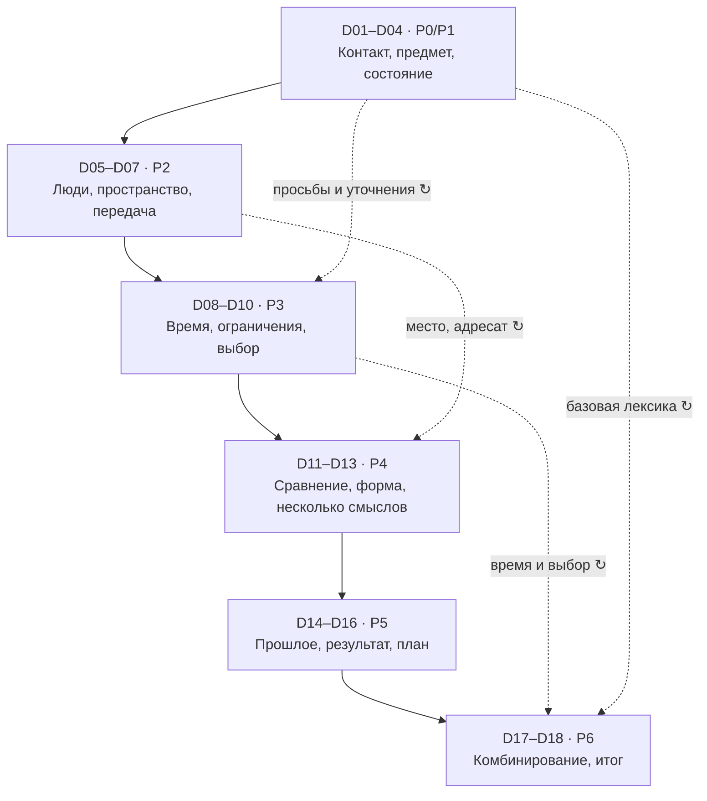
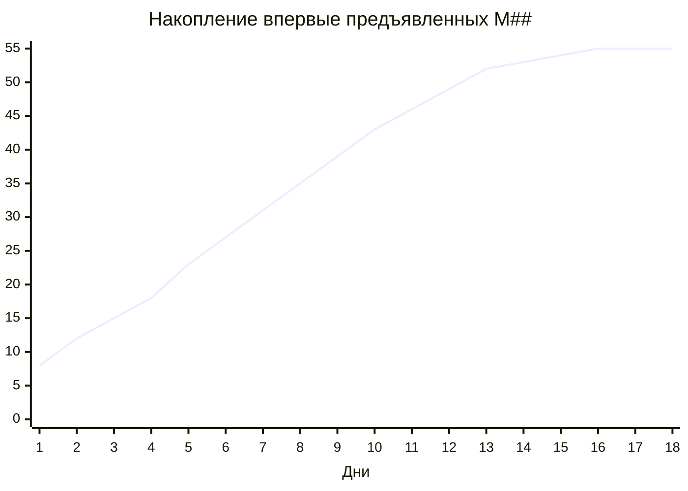
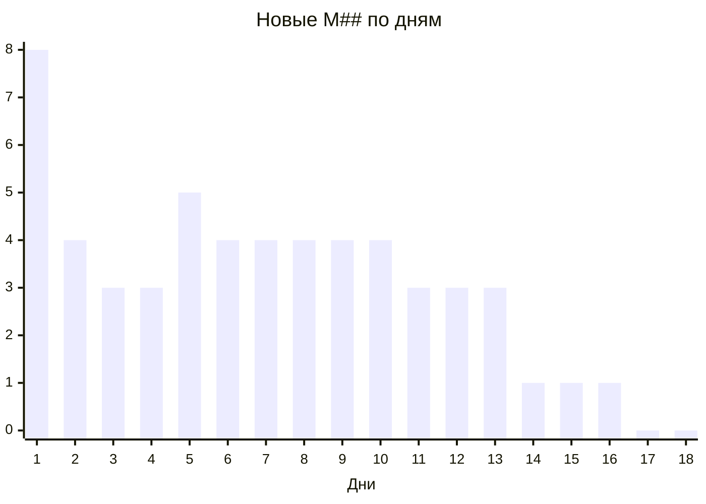
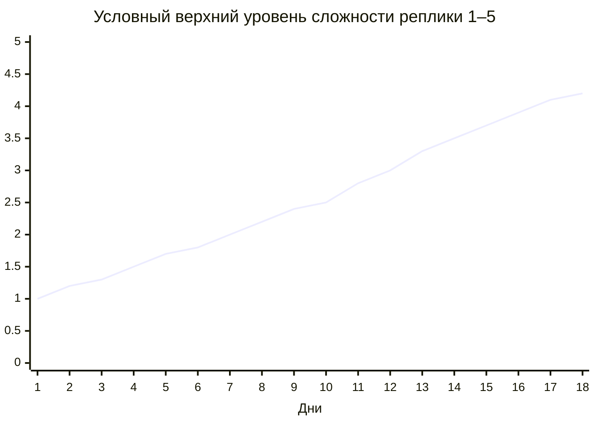

# Визуальная карта первого акта: дни × языковые возможности

**Статус: проектный графический отчёт v0.1; не утверждённые 18 дней и не новый сюжет.**  
**Интерактивная визуализация:** [ACT_DAY_PROGRESSION_DASHBOARD.html](ACT_DAY_PROGRESSION_DASHBOARD.html) (автономный HTML; скачать raw-файл и открыть в браузере). **Аудит фактической доступности D01–D06:** [DAY_01_06_LANGUAGE_AUDIT.md](DAY_01_06_LANGUAGE_AUDIT.md).

**Источники:** [GAME_DESIGN.md](GAME_DESIGN.md) §2, [CONCEPT_DRAFT.md](CONCEPT_DRAFT.md) §7, [LANGUAGE_MAP.md](LANGUAGE_MAP.md), [LANGUAGE_PROGRESSION.md](LANGUAGE_PROGRESSION.md), [LEARNING_OUTCOMES.md](LEARNING_OUTCOMES.md), [SETTING_MINIMAL_ADAPTATION.md](SETTING_MINIMAL_ADAPTATION.md).

## 1. Дизайнерский принцип

**День = единица авторского сюжета, детерминированных диалогов и перехода ко сну.** Обязательное ядро встречается в естественных основных событиях; NPC и факультативные сцены могут давать дополнительную практику. **P0–P6 = языковые горизонты, а не игровые дни.** Не требуются адаптивная сложность, выборы вместо свободного немецкого ввода и новая механика писем.

Для первого полного графического макета сознательно выбрана **условная сетка D01–D18**. В репозитории **подробно описаны D01–D06**, а D07–D18 ниже — **слоты под будущий сценарий, не утверждённые события**. Даже для D01–D06 размещение конкретных M## пока лишь *гипотеза* и может оказаться слишком плотным для A0.

**Нельзя выводить из этих графиков, что игрок за 18 дней освоит A1 или запомнит все 55 M##.** На графиках показаны только *возможности* значимого первого применения и повторного использования. Длина акта станет ясна после написания коротких немецких контактов и оценки их нагрузки.

## 2. Общее нарастание навыков



**Сюжетная опора D01–D06:** пробуждение и ремонт с Леной → диагностика и медик → восстановление дальней связи → медик и биолог → калибровка датчиков → личные сообщения с Земли. **После шестого дня** таблица описывает только типы возможной коммуникации, не сюжетные сцены или решения о персонажах.

## 3. Предложенное распределение 55 M## по 18 игровым дням

| День | Горизонт | Основа или возможная жизненная ситуация | Первое значимое применение | Статус |
|---|---|---|---|---|
| **D01** | P0 | Пробуждение, Лена, медик, получение детали | M01, M04, M05, M06, M09, M12, M39, M40 | Есть сюжетная основа; M## предложены |
| **D02** | P1 | Медик и диагностика состояния | M10, M11, M15, M29 | Есть сюжетная основа; M## предложены |
| **D03** | P1 | Совместная работа с Леной на расстоянии | M07, M41, M47 | Есть сюжетная основа; M## предложены |
| **D04** | P1 | Медик и биолог, простые потребности | M02, M03, M32 | Есть сюжетная основа; M## предложены |
| **D05** | P2 | Навигатор, датчики, место и числа | M17, M20, M21, M22, M49 | Есть сюжетная основа; M## предложены |
| **D06** | P2 | Письма с Земли и общение об отношениях | M08, M13, M35, M53 | Есть сюжетная основа; M## предложены |
| **D07** | P2 | Согласование помощи и передача фактов | M14, M19, M33, M48 | Новый условный слот; сюжет не утверждён |
| **D08** | P3 | Расписание и доступность людей | M18, M23, M24, M42 | Новый условный слот; сюжет не утверждён |
| **D09** | P3 | Правила, ограничения, порядок действий | M25, M26, M54, M55 | Новый условный слот; сюжет не утверждён |
| **D10** | P3 | Предпочтение, выбор, приглашение | M30, M31, M37, M43 | Новый условный слот; сюжет не утверждён |
| **D11** | P4 | Сравнение фактов и результатов | M16, M28, M38 | Новый условный слот; сюжет не утверждён |
| **D12** | P4 | Небольшая форма и короткая рабочая запись | M27, M44, M45 | Новый условный слот; сюжет не утверждён |
| **D13** | P4 | Интересы, отношения и связные смыслы | M34, M36, M46 | Новый условный слот; сюжет не утверждён |
| **D14** | P5 | Понять короткий факт о прошлом | M50 | Новый условный слот; сюжет не утверждён |
| **D15** | P5 | Самостоятельно сообщить прошлый результат | M51 | Новый условный слот; сюжет не утверждён |
| **D16** | P5 | Сформулировать ближайший план | M52 | Новый условный слот; сюжет не утверждён |
| **D17** | P6 | Интеграция: последствия и завершение задач | — | Новый условный слот; сюжет не утверждён |
| **D18** | P6 | Финал акта, проверка уже знакомых возможностей | — | Новый условный слот; сюжет не утверждён |

**Проверка структуры:** 55/55 M## разнесены однократно по первоначальному языковому горизонту; к D06 расположено 27 первых встреч, D07–D16 ещё 28; D17–D18 не вводят новых обязательных M##. **Уточнение после аудита:** M12 (самостоятельная короткая просьба) перенесён с D03 в D01, потому что получение детали у снабженца уже обязательное событие первого дня. Это **ранняя смысловая формула P1 внутри дня с преобладанием P0**, а не требование всей грамматики P1. **Особое ограничение:** 27 M## за 6 дней — **не измеренная нагрузка и не доказанная перегрузка**. Например, чтение краткой реплики и распознавание побуждения могут происходить в одной ситуации; а широкий навык продуктивной модальности требует нескольких разных контрастов. Подробно: [DAY_01_06_LANGUAGE_AUDIT.md](DAY_01_06_LANGUAGE_AUDIT.md). Самостоятельная продукция и первое узнавание должны проверяться отдельно. M08/M55 рецептивны и не равны по сложности широким продуктивным навыкам.

## 4. Накопление доступных функций — не освоение



Количество впервые встреченных M## — **не количество выученных слов** и не прогноз готовности к экзамену.

## 5. Новые навыки за день



**Число ID не равно когнитивной нагрузке.** P5 вводит мало новых ID, но формы прошедшего могут быть труднее многих ранних коммуникативных функций. В отдельных днях допустима и полезна практика без новых конструкций.

## 6. Матрица повторений прежних групп

**●** впервые используется новая функция группы; **↻** осмысленное возвращение *старой* группы в иной задаче; **◉** новое и повторное применение в одном дне; **·** явный возврат не запланирован. Каждая клетка — **пожелание к будущему контракту диалога**, не фактически написанный диалог.

| Группа | D01 | D02 | D03 | D04 | D05 | D06 | D07 | D08 | D09 | D10 | D11 | D12 | D13 | D14 | D15 | D16 | D17 | D18 |
|---|---|
| **P0** | ● | ↻ | ↻ | ↻ | ↻ | ↻ | ↻ | · | ↻ | ↻ | · | ↻ | ↻ | · | ↻ | ↻ | ↻ | ↻ |
| **P1** | ● | ● | ◉ | ◉ | ↻ | ↻ | ↻ | ↻ | ↻ | ↻ | ↻ | · | ↻ | ↻ | ↻ | · | ↻ | ↻ |
| **P2** | · | · | · | · | ● | ◉ | ◉ | ↻ | ↻ | ↻ | ↻ | ↻ | ↻ | ↻ | ↻ | ↻ | ↻ | ↻ |
| **P3** | · | · | · | · | · | · | · | ● | ◉ | ◉ | ↻ | ↻ | ↻ | ↻ | ↻ | ↻ | ↻ | ↻ |
| **P4** | · | · | · | · | · | · | · | · | · | · | ● | ◉ | ◉ | ↻ | ↻ | ↻ | ↻ | ↻ |
| **P5** | · | · | · | · | · | · | · | · | · | · | · | · | · | ● | ◉ | ◉ | ↻ | ↻ |

*Например:* `noch einmal` впервые нужен в начальной аварии, затем может помогать уточнять **время** или **отрицание**; просьба о детали в ранних днях возвращается как **личная просьба** и позже как часть **составного высказывания**. Появление слова без реальной смысловой необходимости **не** подтверждает ↻.

## 7. Ожидаемая кривая сложности языка



**Это экспертно предложенная *условная* шкала 1–5, не объективный индекс немецкого и не средняя сложность дня.**  
1 = ясная короткая просьба с предметом; 2 = человек/место/адресат; 3 = время/выбор/отрицание и два факта; 4 = несколько связанных смыслов, простое прошлое; 5 = свободное комбинирование нескольких ранее известных функций. В D18 простые реплики D01 **не исчезают**.

Искомая форма — **плавный старт, более быстрый рост самостоятельности в середине, затем консолидация**, а не математическая парабола с произвольно назначенной кривизной. **Кривая сложности и кривая количества новых ID — разные графики.**

| Иллюстративный день | Что игрок уже может сказать по-немецки |
|---|---|
| D01 | `Ja.` / `Nein.` / `Noch einmal, bitte.` |
| D03 | `Ich brauche das Buch.` |
| D06 | `Anna hat das Buch.` |
| D08 | `Komm morgen um drei.` |
| D11 | `A ist kaputt, B ist okay.` |
| D15 | `Ich habe das Buch gefunden.` |
| D17 | `Ich habe es gefunden. Es ist im Zimmer. Komm morgen.` |

Это **доступные примеры смысла**, не обязательные дословные варианты ответа парсера.

## 8. Применение к будущему сценарию

1. **Сохранять дни, детерминированные диалоги, переход сна и свободу дополнительных разговоров.** P0–P6 не превращать в скрытую систему «уроков».
2. Для каждого дня описать **основной сюжетный смысл, немецкую информацию и самостоятельное действие игрока**. Только после этого подтверждать M## и клетку ↻.
3. У каждого обязательного результата LO-R01–R06/LO-W01–W07 должно быть **естественное обязательное применение**, а значимые ранние навыки — возвращаться в других обстоятельствах.
4. **Форма LO-W06:** отдельная минимальная механика с немецкими именами полей, без парсера свободного ввода. **LO-W07:** обычный свободный письменный диалог, никакого обязательного исходящего письма.
5. **Не выдумывать прошлое для второго дня:** описание текущих показаний достаточно; продуктивные формы прошлого не обязательны до P5.
6. Если реальные диалоги P0–P2 окажутся слишком плотными, **растянуть горизонт на дополнительные дни**, а не ускорять язык ради красивого графика.
7. Этот документ не фиксирует число дней, нового сюжета после D06, выбранного сеттинга, оценки памяти и готового экзамена. Следующий шаг — **содержательное согласование масштаба**, затем планирование S1/S2.

### Обновление визуального отчёта при изменении программы

Хранить таблицу дневных M##, матрицу ↻ и условную кривую сложности здесь как рабочие исходные данные. После их правки из корня репозитория выполнить:

```bash
python implementations/story_rpg/tools/build_day_progression_dashboard.py
python implementations/story_rpg/tools/build_day_progression_dashboard.py --check
```

Скрипт без зависимостей синхронизирует встроенные данные [HTML-дашборда](ACT_DAY_PROGRESSION_DASHBOARD.html), проверяет уникальность 55 M## и согласованность числа дней с матрицей возвратов и кривой. **Редактируемый текст аудита D01–D06 проверять вручную**, особенно если меняются немецкие реплики или сюжет; генератор не подтверждает педагогическую доступность сцен. **HTML и Markdown коммитить в одном PR.** При изменении числа дней не забывать менять и дневную таблицу, и все 6 рядов матрицы, и кривую.

**Сводка:** принятой моделью остаются день + авторский граф + свободный немецкий ввод; карта показывает *как впервые дать навыки и вернуть их позднее*, а не как гарантировать их запоминание.
