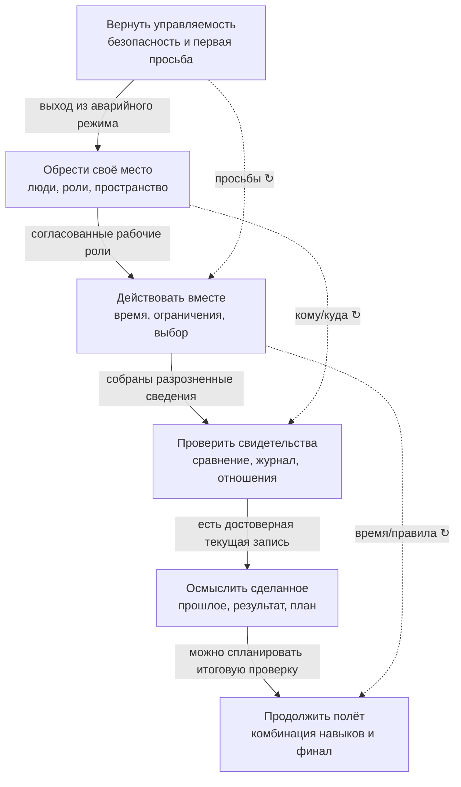
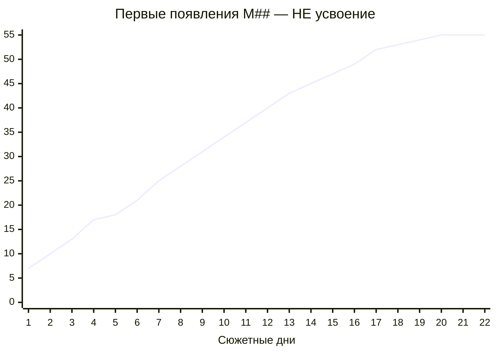
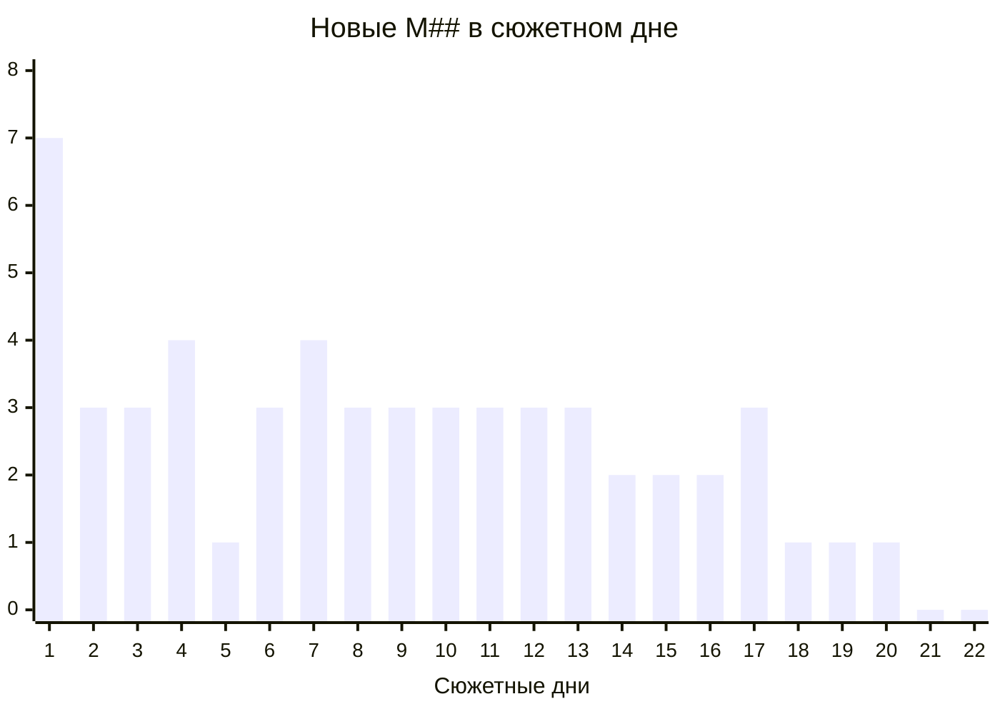
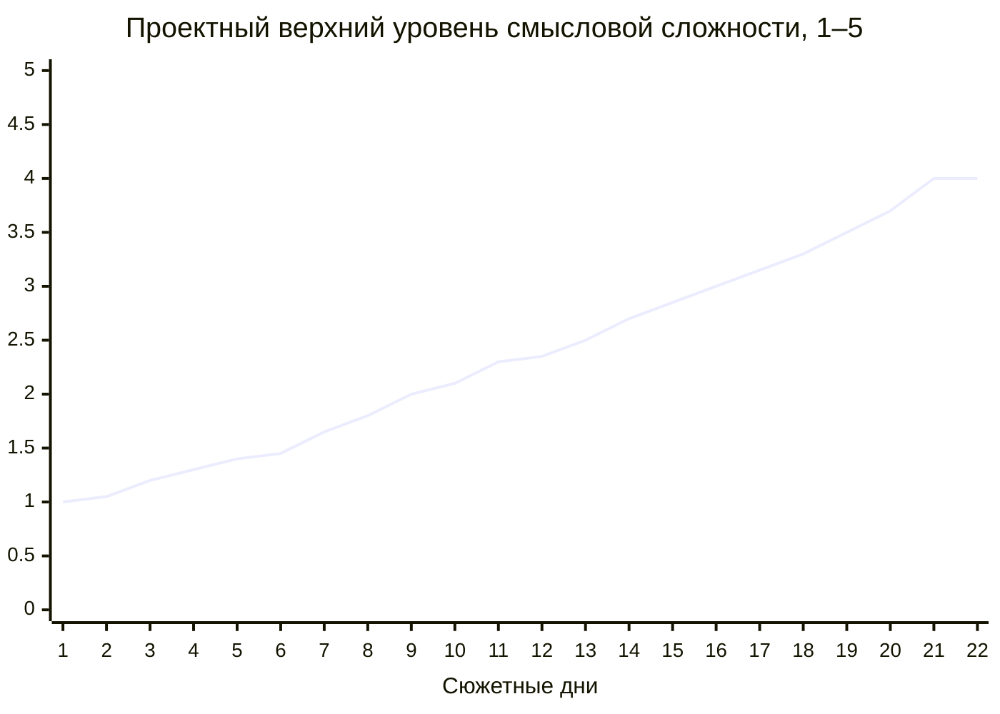

# Чистая дневная карта первого акта: события → язык → возвращения

**Статус: clean-room storyboard v0.2; 22 дневных слота — проектная гипотеза, не утверждённая длительность.**  
**Главный источник причинности:** [ACT_CLEAN_ROOM_BLUEPRINT.md](ACT_CLEAN_ROOM_BLUEPRINT.md). **Не использованы для расчёта** прежние D01–D06, их квесты или распределение по 18 дням. Новая расстановка M## предложена из сюжетных задач этого документа, а не перенесена со старой диаграммы.  
**Рост общего словаря:** [сценарный отчёт](ACT_DIALOGUE_LOAD_REPORT.md) §4 и [HTML-кривые](ACT_DAY_PROGRESSION_DASHBOARD.html) показывают новые / повторные слова и накопленные уникальные R-лексемы по D01–D21, отдельно от P-образцов. Данные берутся из [единых сценовых контрактов](ACT_DIALOGUE_SITUATIONS.json); прежний пилот сохранён только как история исследования.  
**Аудит удельного веса входящего и исходящего языка:** [ACT_LANGUAGE_LOAD_AUDIT.md](ACT_LANGUAGE_LOAD_AUDIT.md) (методика, 29 групп); текущий [сценарный расчёт](ACT_DIALOGUE_LOAD_REPORT.md) — 37 обязательных и 5 факультативных ситуаций. Это авторский проект, а не реализованный игровой корпус.  
**Интерактивный отчёт:** [ACT_DAY_PROGRESSION_DASHBOARD.html](ACT_DAY_PROGRESSION_DASHBOARD.html); **генератор:** `implementations/story_rpg/tools/build_day_progression_dashboard.py`.

## 1. Сначала сюжетная причинность



| Часть | Задача истории | Проверяемый исход |
|---|---|---|
| **Слоты 01–05** | Вернуть управляемость | Состояние героя и безопасное место |
| **Слоты 06–09** | Обрести место среди людей | Доступ, ответственные, передача сведений |
| **Слоты 10–13** | Научиться действовать вместе | Общий график, правила и выбор |
| **Слоты 14–17** | Сопоставить интересы и факты | Два измерения, документ, конфликт |
| **Слоты 18–20** | Осмыслить сделанное | Короткое прошлое, результат, план |
| **Слоты 21–22** | Продолжить путь | Коллективная проверка, итог |

**Пояснение числа 22:** это **счёт предложенных авторских изменений мира**, каждому из которых для первого монтажа назначен самостоятельный дневной переход. Никаких нормативных оснований для числа 22 нет. Если две последовательные сцены помещаются в один сюжетный день, их можно объединить; если без перегрузки A0 не получается — разделить. **Дни = сценарные контейнеры, а не уроки языка.**

## 2. Дневная модель — сюжетные исходы

| День | Доступный горизонт | Действие игрока с сюжетной причиной | Первое осмысленное знакомство с M## | Изменение мира после дня | Статус |
|---|---|---|---|---|---|
| **D01** | P0 | Локализовать риск после внезапного пробуждения | M01, M04, M05, M06, M09, M39, M40 | Участок безопасен для выхода; герой понимает ближайшую цель | Чистая гипотеза, не утверждено |
| **D02** | P1 | Вернуть самостоятельность после осмотра | M02, M03, M29 | Медик устанавливает реальное состояние; герой получает отдых | Чистая гипотеза, не утверждено |
| **D03** | P1 | Получить необходимые вещи без сопровождения | M07, M12, M32 | Распределён ресурс для бытовой и рабочей потребности | Чистая гипотеза, не утверждено |
| **D04** | P1 | Проверить состояние основного контура | M10, M11, M15, M41 | Выявлено, чего действительно нет и что работает | Чистая гипотеза, не утверждено |
| **D05** | P1 | Завершить первую полезную рабочую задачу | M47 | Восстановлен доступ к общей зоне; герой признан полезным | Чистая гипотеза, не утверждено |
| **D06** | P2 | Освоить пространство и доступные маршруты | M20, M21, M22 | Открыт безопасный путь к жилой и рабочей части | Чистая гипотеза, не утверждено |
| **D07** | P2 | Определить владельцев вещей и ответственных | M08, M13, M33, M53 | Герой знает, к кому обращаться, а чужое остаётся чужим | Чистая гипотеза, не утверждено |
| **D08** | P2 | Согласовать действия между двумя рабочими местами | M14, M19, M48 | Сведения с разных станций объединены и проверка закончена | Чистая гипотеза, не утверждено |
| **D09** | P2 | Сверить учёт ресурсов и состояние команды | M17, M35, M49 | Снабженец может безопасно распределить известный остаток | Чистая гипотеза, не утверждено |
| **D10** | P3 | Согласовать подходящую смену и обследование | M23, M24, M42 | Установлено доступное окно работ без ожидания NPC | Чистая гипотеза, не утверждено |
| **D11** | P3 | Уточнить правила доступа и ответственность | M18, M54, M55 | Определены безопасные границы действий экипажа | Чистая гипотеза, не утверждено |
| **D12** | P3 | Сделать личный выбор во время восстановления | M30, M31, M43 | Медик учитывает безопасное предпочтение, меняется распорядок | Чистая гипотеза, не утверждено |
| **D13** | P3 | Утвердить совместный порядок действий | M25, M26, M37 | Два специалиста договорились о последовательности проверки | Чистая гипотеза, не утверждено |
| **D14** | P4 | Разрешить противоречие двух свежих измерений | M16, M28 | Отличены надёжный результат и ошибочное показание | Чистая гипотеза, не утверждено |
| **D15** | P4 | Проверить происхождение рабочей записи | M27, M44 | Получены ограничения для проверки без разгадки аварии | Чистая гипотеза, не утверждено |
| **D16** | P4 | Оформить проверенное состояние в журнале | M45, M46 | Следующая смена получает точную запись работ | Чистая гипотеза, не утверждено |
| **D17** | P4 | Увидеть конфликт приоритетов экипажа | M34, M36, M38 | Решение о ресурсе принято уполномоченными, отношения изменились | Чистая гипотеза, не утверждено |
| **D18** | P5 | Прочитать прошлое действие по короткой записи | M50 | Установлена последовательность известного события, не его истинная причина | Чистая гипотеза, не утверждено |
| **D19** | P5 | Отчитаться о собственном завершённом ремонте | M51 | Коллега использует достоверный результат для итоговой проверки | Чистая гипотеза, не утверждено |
| **D20** | P5 | Согласовать план заключительного теста | M52 | Команда распределила роли, время и дальнейшие действия | Чистая гипотеза, не утверждено |
| **D21** | P6 | Выполнить коллективную проверку устойчивости | — | Корабль подтверждён пригодным к следующему этапу пути | Чистая гипотеза, не утверждено |
| **D22** | P6 | Закрыть последствия и пройти отдельную языковую проверку | — | История завершается продолжением полёта; экзамен допускает пересдачу | Чистая гипотеза, не утверждено |

**Статус всех строк — новый проектный вариант.** Не нужно выполнять каждую функцию M## в виде отдельного задания. `P1` — горизонт языка, не требование «герой освоил P1 после сна». Свободные занятия и отношения могут идти параллельно каждому основному событию и не являются обязательным экзаменационным контентом.

## 3. Накопление первых доступных коммуникативных функций



**Всего 55/55 M## получили одну первичную сюжетную опору, но это не доказательство практической достаточности, владения формами или запоминания.** Границы R/P для каждого M## хранятся в [LANGUAGE_MAP.md](LANGUAGE_MAP.md). M08, M27 и M55 — примеры существенного **рецептивного**, а не обязательного полного продуктивного требования.

## 4. Темп нового материала



Число M## **не является научной единицей сложности**. Ранние функции чтения могут впервые встречаться в одной реплике, а позднее сложное различие может потребовать нескольких дней значимого повторения.

## 5. Тепловая матрица возвращений

**●** первая встреча хотя бы с одним M## группы; **◉** первая встреча + смысловое возвращение знакомой функции; **↻** старые функции снова нужны в **новой сюжетной цели**; **·** явного возврата здесь нет.

| Группа | D01 | D02 | D03 | D04 | D05 | D06 | D07 | D08 | D09 | D10 | D11 | D12 | D13 | D14 | D15 | D16 | D17 | D18 | D19 | D20 | D21 | D22 |
|---|---|---|---|---|---|---|---|---|---|---|---|---|---|---|---|---|---|---|---|---|---|---|
| **P0** | ● | ↻ | ↻ | ↻ | ↻ | ↻ | ↻ | · | ↻ | ↻ | · | ↻ | · | · | ↻ | · | ↻ | · | ↻ | · | ↻ | ↻ |
| **P1** | · | ● | ◉ | ◉ | ◉ | ↻ | ↻ | ↻ | ↻ | · | ↻ | ↻ | ↻ | ↻ | · | ↻ | ↻ | ↻ | ↻ | ↻ | ↻ | ↻ |
| **P2** | · | · | · | · | · | ● | ◉ | ◉ | ◉ | ↻ | ↻ | ↻ | ↻ | ↻ | ↻ | ↻ | ↻ | ↻ | ↻ | ↻ | ↻ | ↻ |
| **P3** | · | · | · | · | · | · | · | · | · | ● | ◉ | ◉ | ◉ | ↻ | ↻ | ↻ | ↻ | ↻ | · | ↻ | ↻ | ↻ |
| **P4** | · | · | · | · | · | · | · | · | · | · | · | · | · | ● | ◉ | ◉ | ◉ | ↻ | ↻ | ↻ | ↻ | ↻ |
| **P5** | · | · | · | · | · | · | · | · | · | · | · | · | · | · | · | · | · | ● | ◉ | ◉ | ↻ | ↻ |

Проверять ↻ только после написания конкретных диалоговых контрактов: **одно произнесённое знакомое слово без самостоятельного понимания/действия не является возвратом**. Группы не обязаны повторяться в каждом дне.

## 6. Графическое усложнение доступных смыслов

Показан условный **верхний предел требуемых комбинаций смыслов**, а не средняя длина всех реплик, скорость изучения, грамматический уровень или прогноз оценки игрока. После появившихся сложных сообщений `Ja`, `Bitte`, `Was ist das?` продолжают быть полезны.



**Не обязательная парабола:** плавная ступенчатая линия с выходом на плато; нарастание **комбинаций знакомого** может продолжаться, даже когда новых M## уже нет. Сложность сюжета и сложность немецкого различаются.

## 7. Минимальный диалоговый контракт каждого дня

Эти краткие R/P/контрасты определены **после** сюжетного действия. Это ещё не тексты реальных NPC и не тесты парсера. Немецкие образцы — смысловые ориентиры; не требовать буквальных строк. **Столбец «Что нужно различить» обязателен к проверке в будущем редакторе диалогов.**

| День | Понять по-немецки (R) | Сказать или сделать после понимания (P) | Что нельзя угадать из русского интерфейса |
|---|---|---|---|
| **D01** | Понять Hallo, Nimm das Teil, Ja/Nein и нужный предмет | Самому попросить повторить или подтвердить действие | Другая деталь вместо требуемой не подходит |
| **D02** | Распознать wer/ich/du и короткий вопрос о самочувствии | Ich bin müde или другая простая самостоятельная оценка | Ja без состояния не объясняет, что именно чувствует герой |
| **D03** | Понять вопрос что/где и различить предметы/напитки | Wasser, bitte / Ich brauche das Teil | Просьба о воде не означает просьбу о детали |
| **D04** | Различить ist kaputt / ist nicht kaputt и короткую надпись | Сообщить конкретное состояние и отсутствие | Не перепутать исправный объект с неисправным |
| **D05** | Прочитать короткую отметку, чего ещё не хватает | Самостоятельно спросить где/что необходимо | Подсветка не выдаёт требуемое имя предмета |
| **D06** | Понять Wo? / Wohin? и объект на схеме | Назвать, где предмет и куда его перенести | в комнате ≠ в комнату |
| **D07** | Понять mein/dein и du/Sie из ситуации, роль человека | Сказать, чья вещь и чья работа | Назвать владельца ≠ назначить получателя |
| **D08** | Понять, кто кому передаёт результат | Самому сообщить неизвестный коллеге факт, предложить помощь | Получатель A ≠ получатель B; NPC не знает ответ заранее |
| **D09** | Из короткого списка узнать число и раньше/сейчас | Сообщить количество и простую реакцию о человеке | Два предмета не равны трём; теперь не равно раньше |
| **D10** | Прочитать расписание и чужую занятость | Попросить встречу в понятный день/час | Сегодня в три ≠ завтра в три |
| **D11** | Узнать запрет и вежливую просьбу | Различить можно / нельзя / не обязательно | Darf nicht ≠ muss nicht |
| **D12** | Прочитать короткое приглашение и варианты ухода | Ich möchte Wasser / Lieber später | Чужая подсказка Ja/Nein не выражает собственный выбор |
| **D13** | Понять zuerst/dann, частоту и приглашение | Предложить и согласовать последовательность/время | Сначала A затем B ≠ сначала B затем A |
| **D14** | Прочитать две немецкие подписи с разными результатами | Сравнить два известных значения/состояния | Результат A не принадлежит датчику B |
| **D15** | Понять короткую запись и длительность/границу | Запросить недостающие факты о работе | Время начала ≠ время окончания |
| **D16** | Прочитать имена полей Sensor/Zeit/Status | Заполнить известные поля и своими словами передать два пункта | Нельзя перепутать Sensor A и Sensor B, статус и время |
| **D17** | Понять личную позицию и знакомые имена отношений | Сообщить собственную оценку/предпочтение без права приказать | Мне не нравится ≠ мне запрещено; герой не решает спор вместо снабженца |
| **D18** | Понять gestern/war/hat и факт из прошлого | Уточнить, о каком известном событии речь | Прошлая запись ≠ текущий статус |
| **D19** | Понять короткую просьбу о выполненной работе | Ich habe den Sensor geprüft / иная понятная краткая форма | Сделал A ≠ сделал B; морфологическая ошибка сама по себе не блокирует |
| **D20** | Понять короткий будущий план и адресатов | Самостоятельно назвать следующий шаг и его время | Сейчас ≠ завтра; кому именно нужно прийти |
| **D21** | Прочитать итоговые данные и ограничения | Самому объединить состояние, адресата, время и просьбу | Нельзя завершить только кнопками без понимания немецких данных |
| **D22** | Понять новый короткий набор личных и рабочих текстов | Свободно ответить, заполнить форму и связать несколько смыслов | Проверять знакомое ядро; нет новой лексики, неожиданного письма или полного A1-сертификата |

## 8. Трассировка всех 13 результатов LO## в проектной истории

| Результат | Кандидаты обязательных контактов | Что должно быть подтверждено диалоговым контрактом |
|---|---|---|
| **LO-R01** | D01, D07, D11 | короткая команда, обращение, узнавание вежливой формулы |
| **LO-R02** | D04, D11, D14 | отрицание, запрещено/не обязательно, сопоставление фактов |
| **LO-R03** | D06, D08, D21 | место/направление меняют работу с объектом |
| **LO-R04** | D09, D10, D15, D16 | число/время, таблица, граница времени и имена полей |
| **LO-R05** | D12, D15, D18, D22 | сообщение и рабочая заметка, факты прошлого |
| **LO-R06** | D14, D16, D18 | сопоставить два независимых прочитанных факта |
| **LO-W01** | D03, D05, D08, D21 | самостоятельно попросить/уточнить у разных людей |
| **LO-W02** | D04, D06, D14, D21 | описать объект, состояние, место/отрицание |
| **LO-W03** | D10, D11, D13, D20, D21 | согласовать время и возможность с человеком |
| **LO-W04** | D02, D03, D12, D17 | состояние, потребность, свободное предпочтение |
| **LO-W05** | D08, D16, D19, D21 | передать известный существенный факт и поздний результат |
| **LO-W06** | D16, D22 | поля краткой рабочей записи; в проверке иной простой документ |
| **LO-W07** | D16, D21, D22 | несколько связанных собственных смыслов в обычном диалоге |

**LO-W06:** короткая редактируемая форма (например, Sensor/Zeit/Status), а не вызов свободного парсера; **LO-W07:** несколько связанных смыслов самостоятельно в обычном письменном диалоге; отдельная почта не нужна. **Обязательный контраст** `darf nicht` ≠ `muss nicht` — только после доступного знакомства с модальностью. Сложный Perfekt не появляется в ранних событиях.

## 9. Что требуется подтвердить до принятия длительности акта

1. **Подготовка языка.** Для каждого слота проверить реальную доступность немецкого абсолютному новичку с F1, а не только наличие M## в таблице. Не вводить новое сложное слово вместе с несколькими новыми смысловыми различиями.
2. **Повторы:** каждый ↻ связан с новым осмысленным действием, а не с одинаковым диалогом, повторённым ради статистики. Если нет подходящего повтора — нужно пересмотреть сюжетный эпизод или добавить новый день, **а не объявлять усвоение**.
3. **Время в мире:** проверить, что после события есть естественная граница сна/смены/ожидания и NPC действительно меняют доступность. Можно **объединять** дни без обязательного одного квеста в день.
4. **Причинность:** это одна исходная повреждённая система и связанные решения, а не цепь случайных ремонтов. Профессиональные роли сохраняются; герой не получает права командовать снабженцем или строить траекторию за навигатора.
5. **Тематические области не равны обязательным квестам**, но всё функциональное ядро должно иметь необходимые поводы для использования. Отдельная механика писем не добавляется.
6. **Драматургический финал:** рейс вновь устойчив; тайна аварии не раскрыта; следующий акт открыт. Если крупные личные линии кажутся формальными — это признак нехватки поводов для истории, не призыв добавлять одинаковые диалоги.
7. **Экзамен:** отдельный, повторяемый, без F1, без внезапных смыслов и без ложного утверждения о достижении полного сертифицированного A1.
8. **Удельный вес диалогов:** [ACT_LANGUAGE_LOAD_AUDIT.md](ACT_LANGUAGE_LOAD_AUDIT.md) разбирает 29 тематических групп, разделяет обязательные R-встречи и P-возможности и фиксирует явные тематические пробелы, в особенности после D18. Для [42 связных сценарных ситуаций](ACT_DIALOGUE_LOAD_REPORT.md) доли и накопительный словарь уже пересчитаны на обязательном пути отдельно от необязательного; однако вариативные ветви, реальные игроки и фактическое понимание **не измерены**. Нельзя выводить практическую достаточность из M##, R/P-контрактов или маркеров ↻.
9. **Продолжительность:** **22 — один конкретный монтаж**, не «рассчитанное оптимальное количество дней». Реальную оценку затрат в диалогах и возможность объединения/разведения событий нужно сделать до фиксации дней; нет правдоподобного прогноза времени обучения по одному макету.

### Генератор HTML

После правки дневной таблицы, сценовых диалогов, нормализации слов, тепловой матрицы, кривой сложности **или языковой матрицы** обновлять оба отчёта в том же PR:

```bash
python implementations/story_rpg/tools/analyze_dialogue_load.py
python implementations/story_rpg/tools/build_day_progression_dashboard.py
python implementations/story_rpg/tools/analyze_dialogue_load.py --check
python implementations/story_rpg/tools/build_day_progression_dashboard.py --check
```

Генератор читает **проектную модель дней и контрактов** из этого файла, имена M## из `LANGUAGE_DESIGN.md` и категорию M## из `LANGUAGE_MAP.md`, а **реальные слова авторских сцен** — из `ACT_DIALOGUE_SITUATIONS.json` через валидатор `tools/scene_corpus.py`. Лексические группы и нормализация берутся из отдельных каталогов. HTML — **визуальное представление этого источника**, не отдельный источник истины.

**Не использовать в качестве текущего плана:** предыдущую версию на 18 дней и старый шестидневный аудит; они не служат базой clean-room-модели. Не переносить сюда готовые квесты без проверки их причинной роли.
