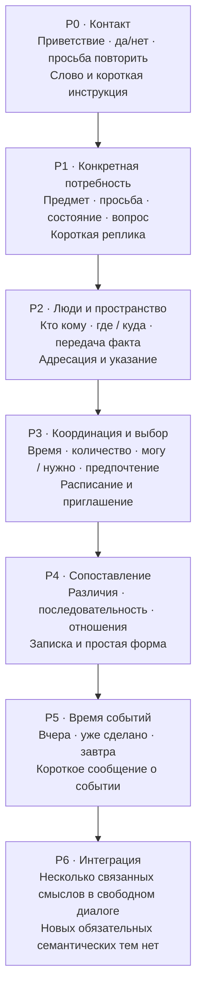
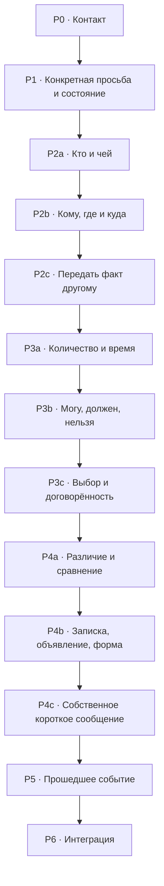
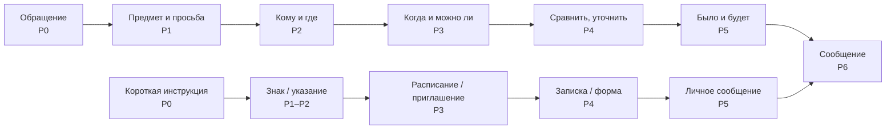

# Карта языковой прогрессии A0 → письменный A1

**Сводка всех направлений и оставшихся работ:** [LANGUAGE_PROGRAM_ROADMAP.md](LANGUAGE_PROGRAM_ROADMAP.md). Нынешняя карта R/P/↻ продолжает быть самостоятельным источником прогрессии.  

**Статус: v0.4 — визуальная карта связана с [переносимым лексическим каталогом](LANGUAGE_LEXICON.md) и [проверяемыми результатами](LEARNING_OUTCOMES.md); проектный черновик, не утверждённый стандарт.**  
**Принцип:** **одна** сеттинг-независимая программа. Эта карта визуализирует [LANGUAGE_DESIGN.md](LANGUAGE_DESIGN.md), [LANGUAGE_PROGRESSION.md](LANGUAGE_PROGRESSION.md), [LEARNING_OUTCOMES.md](LEARNING_OUTCOMES.md) и [LANGUAGE_LEXICON.md](LANGUAGE_LEXICON.md). Результат ревью — [LANGUAGE_REVIEW.md](LANGUAGE_REVIEW.md); состояние — [PROJECT_STATUS.md](PROJECT_STATUS.md).

## 1. Как читать карту

- **P0–P6 — не дни, не уровни опыта и не обязательные уроки.** Это **горизонты языковых возможностей**. Позднее знакомые короткие фразы продолжают использоваться; P6 не означает, что простое общение исчезло.
- **Каждая следующая пачка наращивает предыдущие.** Диаграмма показывает *порядок основных новых смысловых возможностей*, а не всю сложную сеть возможных сочетаний немецкого.
- **Три разных события для навыка:** **R** — впервые понять смысл в немецком тексте; **P** — впервые самостоятельно выразить; **↻** — осмысленно применить или прочитать снова при **другой цели или с другим адресатом**. Одного попадания в список недостаточно.
- **Нормативные немецкие примеры — не белый список для парсера.** Неверные окончания и порядок слов не должны блокировать однозначный смысл. Не путать `darf nicht` (нельзя) с `muss nicht` (не обязан).
- **Обязательное ядро** — значимые возможности в главном пути, не экзамен по 55 отдельным навыкам. Память игрока не отслеживается, число повторений не считается доказательством усвоения.

## 2. Карта нарастания по семантическим пачкам

| Горизонт | Новая пачка | Что теперь можно выразить или понять | Параллельно: типы текста | ID первого значимого применения |
|---|---|---|---|---|
| **P0** | Первый контакт | Приветствие, Ja/Nein, повторение, предмет, простая инструкция | Реплика и подпись | M01, M04, M05, M06, M09, M39, M40 |
| **P1** | Предмет, потребность, состояние | Самостоятельная просьба, вопрос, отсутствие, самочувствие, еда | Короткий вопрос, ответ, знак | M02, M03, M07, M10, M11, M12, M15, M29, M32, M41, M47 |
| **P2** | Люди и пространство | Владелец, получатель, где/куда, передать другому, простые числа и чувства | Короткое указание, адресат | M08, M13, M14, M17, M19, M20, M21, M22, M33, M35, M48, M49, M53 |
| **P3** | Время, выбор, договорённость | Когда, сколько, можно/нужно, желание, встреча, порядок действий | Расписание, приглашение | M18, M23, M24, M25, M26, M30, M31, M37, M42, M43, M54, M55 |
| **P4** | Сопоставление и короткие тексты | Два факта, сравнение, интересы, бытовые ограничения, простая форма, два пункта в текстовом диалоге | Объявление, записка, форма | M16, M27, M28, M34, M36, M38, M44, M45, M46 |
| **P5** | Прошлое и ближайшее будущее | Что было, что уже сделано, что будет; знакомые короткие формы Perfekt | Короткая история и ответ | M50, M51, M52 |
| **P6** | Интеграция ранее доступного | Самостоятельный смысл с предметом, адресатом, временем, просьбой и результатом | Несколько связанных пунктов в обычном свободном текстовом диалоге; отдельное письмо необязательно | — |

**Ключевой момент:** P6 — **сочетание** ранее доступных способов общения, а не внезапное появление продуктивного письма. Устный канал не требуется: с P0 немецкий читается и вводится **письменно**. Все обычные диалоги уже письменные; отдельная переписка не является новым обязательным механизмом P6.

### Микрошаги внутри больших горизонтов P2–P4

**P2–P4 разделены на небольшие смысловые прибавления**, чтобы 9–13 ID не выглядели одной учебной порцией. Подпакеты показывают **примерный порядок знакомства с различиями**, а не новые дни, уроки или условия разблокировки.

| Подпакет | Новое значимое различие | Ранее знакомая опора | Что не вводить одновременно |
|---|---|---|---|
| **P2a** | кто, чей предмет и лицо высказывания | имя, знакомая вещь, «мой/твой» | все формы местоимений и Dativ |
| **P2b** | кому передать и где/куда | знакомая просьба, местоимения «мне/тебе», место | полный набор пространственных предлогов |
| **P2c** | передать знакомый факт другому человеку | понятные адресат, место и состояние | множество новых объектов и событий |
| **P3a** | количество → момент времени → расписание | небольшие числа, сегодня/завтра | сложные даты и длительности |
| **P3b** | могу / должен / нельзя / не обязан | знакомые действия и отрицание | сразу оба отрицания модальности без контрастного контекста |
| **P3c** | желание, предпочтение, встреча и отказ | знакомые вещи, время и люди | одновременно новые формы вежливости и все социальные темы |
| **P4a** | различить и сравнить два факта | знакомые состояние, цвет и количество | сложные отчёты и превосходную степень |
| **P4b** | извлечь факт из новой краткой письменной формы | знакомые время, место и просьба | длинное письмо и неизвестные условные конструкции |
| **P4c** | выразить два понятных пункта письменно | короткие собственные реплики P0–P3 | монолог с прошлым временем и несколькими абзацами |

**Возвраты проходят через все подпакеты:** просьба из P1 остаётся полезной в P2–P6, а время P3 снова встречается в записках P4 и личных сообщениях P5–P6.

## 3. Две параллельные дорожки

**Верхняя цепочка** показывает усложнение **передаваемого смысла**. **Нижняя** — расширение **типов читаемых текстов**, а не разные системы ввода. Между ними постоянно происходят переходы: информацию из расписания можно превратить в просьбу, сообщение — в договорённость, а знакомое слово из реплики — использовать в собственном письме. Поэтому граф — **карта связей**, а не строгая единая обязательная цепь прохождения.

## 4. Что входит в обязательное ядро

Трёхуровневая классификация **по требуемому действию**, не по знанию всех грамматических окончаний:

| Маркер | Значение | Результат |
|---|---|---|
| **P — смысловое активное ядро** | Требуется возможность **самостоятельно выразить** смысл в главном пути; одновременно нужна доступность чтения | 42 навыка |
| **R — рецептивное ядро** | Достаточно **осмысленно прочитать**; свободная продукция соответствующей формы не требуется | 13 навыков |
| **E — расширение форм** | Отдельные сложные формы и редкие варианты не обязательны, но не исключают весь коммуникативный навык | Нет целиком исключённых M##; расширения находятся **внутри навыков** |

**Уточнение:** например, M08 (`du/Sie`) относится к обязательному **пониманию**, но не к безошибочному воспроизведению форм. M22 — распознавать место/направление в типичных конструкциях, тогда как продуктивный смысл «где/куда» уже обеспечивают M20/M21. M50 — понимать короткое прошлое событие, а M51 — самостоятельно передать знакомый прошлый результат. M27 (`wie lange`, `seit`, `bis` в простых знакомых выражениях) и M55 (`ich hätte gern`, `könnte ich` как готовые вежливые формулы) входят в **рецептивное ядро**: подобные формулы присутствуют в материалах A1. Свободное образование длительных конструкций и Konjunktiv II **не требуется**; для собственных просьб достаточно понятных простых форм.

**Все M01–M55 классифицированы.** Маркер показывает **минимальную конечную обязанность** (R/P), а E относится к более сложным формам внутри навыка, а не то, что игрок якобы не может написать ничего за рамками. Варианты форм, продуктивность и словарь ограничиваются **смысловой задачей**, не идеальной морфологией. Это **предложенное ядро для согласования**, а не уже утверждённый стандарт.

## 5. Полная карта: первое R → первое P → возврат ↻

**Сквозной аудит фактического сценового покрытия M/G/LO:** [ACT_LANGUAGE_TRACEABILITY_REPORT.md](ACT_LANGUAGE_TRACEABILITY_REPORT.md), [ручная разметка 102 целей](ACT_LANGUAGE_TRACEABILITY.json). Он не заменяет эту спецификацию и не делает авторские примеры подтверждённым усвоением.  

**Этапы ниже — целевые точки для авторского планирования.** Конкретные часы, количество диалогов, дни, текст NPC и сеттинг **не установлены**. «Возврат» означает новую необходимость понять/сказать смысл, **не просто увидеть слово в тексте**. Для R-навыков сохраняется повторное значимое чтение. У P6 как финальной интеграции **нет новых обязательных M##**.

| ID | Ядро | Первое R | Первое P | Содержательный возврат ↻ | Итог |
|---|---|---|---|---|---|
| M01 | **P** | P0 | P0 | P2, P4 | LO-W01 |
| M02 | **P** | P0 | P1 | P3, P4 | LO-W01 |
| M03 | **P** | P0 | P1 | P2, P5 | LO-R01, LO-W01 |
| M04 | **P** | P0 | P0 | P2, P3 | LO-W01 |
| M05 | **P** | P0 | P0 | P2, P4 | LO-W01 |
| M06 | **P** | P0 | P1 | P3, P4 | LO-R01, LO-W01 |
| M07 | **P** | P1 | P1 | P3, P4 | LO-W01 |
| M08 | **R** | P2 | — | P4, P6 | LO-R01 |
| M09 | **P** | P0 | P0 | P2, P3 | LO-W01 |
| M10 | **P** | P1 | P1 | P2, P4 | LO-R02, LO-W02 |
| M11 | **P** | P1 | P1 | P3, P5 | LO-W02 |
| M12 | **P** | P0 | P1 | P2, P4 | LO-W01 |
| M13 | **P** | P2 | P2 | P4 | LO-W02 |
| M14 | **P** | P2 | P2 | P3, P5 | LO-R02, LO-W02 |
| M15 | **P** | P1 | P1 | P4, P5 | LO-W02 |
| M16 | **P** | P3 | P4 | P5, P6 | LO-R06, LO-W05 |
| M17 | **P** | P1 | P2 | P3, P6 | LO-R04, LO-W03 |
| M18 | **P** | P2 | P3 | P4, P6 | LO-R02, LO-W03 |
| M19 | **P** | P1 | P2 | P3, P4 | LO-W01 |
| M20 | **P** | P1 | P2 | P3, P4 | LO-R03, LO-W02 |
| M21 | **P** | P2 | P2 | P3, P4 | LO-R03, LO-W02 |
| M22 | **R** | P2 | — | P4 | LO-R03 |
| M23 | **P** | P2 | P3 | P4, P6 | LO-R04, LO-W03 |
| M24 | **P** | P3 | P3 | P4, P6 | LO-W03 |
| M25 | **P** | P3 | P3 | P4, P5 | LO-W03 |
| M26 | **P** | P3 | P3 | P5, P6 | LO-W05 |
| M27 | **R** | P4 | — | P6 | LO-R04 |
| M28 | **P** | P3 | P4 | P5, P6 | LO-R06, LO-W05 |
| M29 | **P** | P1 | P1 | P3, P4 | LO-W04 |
| M30 | **P** | P2 | P3 | P4, P6 | LO-W04 |
| M31 | **P** | P3 | P3 | P4, P6 | LO-W04 |
| M32 | **P** | P1 | P1 | P3, P4 | LO-W04 |
| M33 | **P** | P2 | P2 | P4 | LO-W04 |
| M34 | **P** | P3 | P4 | P5 | LO-W04 |
| M35 | **P** | P2 | P2 | P4, P6 | LO-W04 |
| M36 | **R** | P4 | — | P5, P6 | LO-R05 |
| M37 | **P** | P3 | P3 | P4, P6 | LO-W03, LO-W04 |
| M38 | **P** | P3 | P4 | P5 | LO-W04 |
| M39 | **R** | P0 | — | P1–P6 | LO-R01 |
| M40 | **R** | P0 | — | P2, P4 | LO-R01 |
| M41 | **R** | P1 | — | P3, P4 | LO-R03, LO-R04 |
| M42 | **R** | P3 | — | P4, P6 | LO-R04 |
| M43 | **R** | P3 | — | P4, P6 | LO-R05 |
| M44 | **R** | P4 | — | P5, P6 | LO-R05 |
| M45 | **P** | P4 | P4 | P6 | LO-W06 |
| M46 | **P** | P3 | P4 | P5, P6 | LO-W07 |
| M47 | **P** | P1 | P1 | P3, P6 | LO-W01 |
| M48 | **P** | P2 | P2 | P4, P6 | LO-R06, LO-W05 |
| M49 | **P** | P2 | P3 | P5, P6 | LO-W03, LO-W05 |
| M50 | **R** | P5 | — | P6 | LO-R05 |
| M51 | **P** | P5 | P5 | P6 | LO-W05 |
| M52 | **P** | P3 | P5 | P6 | LO-W03, LO-W05 |
| M53 | **R** | P2 | — | P4, P5 | LO-R06 |
| M54 | **P** | P2 | P3 | P4, P6 | LO-R02, LO-W03 |
| M55 | **R** | P3 | — | P5, P6 | LO-R01 |

**Неодинаковая интенсивность допустима.** P3 и P4 включают больше разнообразных коммуникативных функций, но они должны появляться **в разных обстоятельствах**; числа ID в пачке — **не** количество новых слов или задач в один день.

## 6. Короткие цепочки роста одной способности

| Исходный смысл | Как он расширяется | Пример независимой от сеттинга цепочки |
|---|---|---|
| **Просьба** | предмет → кто просит → кому → время/условие → записка | `Wasser.` → `Wasser, bitte.` → `Gib mir Wasser, bitte.` → `Bring bitte morgen Wasser.` |
| **Состояние** | назвать → отрицать → сравнить → сообщить изменение | `Die Tür ist offen.` → `Die Tür ist nicht offen.` → `Die andere Tür ist offen.` |
| **Место** | здесь/там → где → куда → записка о месте | `Hier.` → `Das Buch ist im Zimmer.` → `Bring das Buch ins Zimmer.` |
| **Время** | сейчас/позже → количество/час → договориться → план | `Jetzt.` → `Um drei Uhr.` → `Kannst du morgen um drei kommen?` |
| **Личное общение** | имя → самочувствие → предпочтение → приглашение | `Ich bin Mia.` → `Ich bin müde.` → `Ich mag Tee.` → `Kommst du morgen?` |
| **Сообщение** | короткая реплика → прочитанная записка → собственные 2 пункта → 3 пункта | `Wo ist das Buch?` → `Ich bin zu Hause. Komm morgen.` → просьба с местом, временем и смысловым уточнением |
| **Прошлое** | сейчас/вчера → результат → короткое сообщение о прошлом | `Heute.` → `Gestern war ich zu Hause.` → `Ich habe das Buch gefunden.` |

**Важно:** это **примеры смыслового усложнения**, не обязательные дословные реплики и не отдельная пачка мини-квестов. Раннее использование `Wasser` не доказывает, что герой выучил слово; программа лишь предоставляет многократные возможности.

## 7. Холодный старт A0: три проверки на конкретном немецком

**Связанный аудит реальных ранних сценарных контрактов:** [ACT_A0_INPUT_READINESS_REPORT.md](ACT_A0_INPUT_READINESS_REPORT.md) (D01–D09, 14 кейсов). Три теста ниже — методические эталоны, не свидетельство готовности F1 или прохождения A0.  

Это **тест языковой доступности**, не утверждённая игровая сцена.

| Шаг | Немецкий текст и контекст | Что именно требуется | Допустимый результат |
|---|---|---|---|
| **1. Первое обращение** | NPC: `Hallo!` | Игрок видит обращение, по F1 узнаёт приветствие; русская метка — только «Ответить на приветствие» | Самостоятельный `Hallo!`; не нужно склонение |
| **2. Выбор по инструкции** | NPC: `Nimm die Tasse.` Видны **чашка и книга** без подсветки правильного объекта | Игрок должен узнать из F1 `nimm`, `Tasse` и выбрать **чашку** именно по немецкому; русский UI **не** называет её | Взять чашку; взять книгу — не выполнена смысловая инструкция, но можно исправить |
| **3. Своя просьба** | Перед игроком две вещи. Опция на русском: **«Попросить предмет»**, без названия; слово можно найти в F1 | Игрок сам вводит конкретный немецкий предмет и просьбу, например `Tasse, bitte` | Понятная `Tasse, bitte` принимается; одно `Bitte` — не даёт нужного предмета |

**Что не доказано этим тестом:** что новичок обязательно справится с интерфейсом F1, что он запомнил немецкий или что одно упражнение достаточно. Это **проверяемые требования к будущей игровой сцене и UI**. Для реализации понадобится пользовательская проверка с A0, но не отдельная система карточек.

## 8. Ориентир письменного A1 и границы роста

- **Короткое личное сообщение (R):** `Hallo Mia! Ich bin heute krank. Komm bitte morgen um zehn. Danke! Lea.` Игрок должен извлечь отправителя, состояние, просьбу и время на знакомой лексике.
- **Короткое сообщение (P):** `Hallo Tom! Ich bin heute zu Hause. Komm bitte morgen um drei. Danke!` Не нужно уметь написать длинное объяснение причин.
- **Короткий итог произошедшего:** `Gestern war ich zu Hause. Ich habe das Buch gefunden.` Допустима краткая, грамматически несовершенная, но однозначная формулировка.
- **За пределами обязательного A1:** длинные технические отчёты, свободные придаточные с `weil/dass`, сложная реконструкция событий и оценка литературного качества письма.

**Никаких фиксированных баллов, минут, количеств повторений или обязательного количества слов письма здесь не задано.** Пример Goethe A1 примерно на 30 слов — тип короткого функционального сообщения, а не минимальная длина каждой игровой реплики. Формальная оценка конкретных заданий будет предметом более позднего проектирования экзамена.

## 9. Переносимые лексические опоры по горизонтам

Это **классы слов и небольшие проверочные примеры**. Более полный **кандидат переносимого бытового минимума** (29 сфер, активные/рецептивные опоры, аудит Goethe/DW и пробелов) — в [LANGUAGE_LEXICON.md](LANGUAGE_LEXICON.md). Ни этот раздел, ни каталог не являются полным актовым словарём, квотами новых слов или обещанием запоминания к определённому моменту. Все слова акта доступны в F1 с начала; **первая обязательная языковая задача** ограничивается понятным смыслом.

| Горизонт | Нужные смысловые классы | Проверочные немецкие слова и выражения | Следующее использование |
|---|---|---|---|
| **P0** | приветствие, согласие, повтор, объект, действие | Hallo, Danke, Bitte, Ja, Nein, noch einmal, das Buch, die Tasse, nimm | простая просьба и повторение знакомого предмета |
| **P1** | лицо, вопрос, наличие, отрицание, состояние, базовая потребность | ich, du, was, wo, ist, habe, brauche, kein, nicht, offen, müde, Wasser | передача состояния и просьб разным людям |
| **P2** | владелец, адресат, местоположение, направление, малое число | mein, dein, mir, dir, in, auf, zu, hier, dort, der Tisch, das Zimmer, zwei | место встречи, передача факта и план |
| **P3** | время, встреча, возможность, необходимость, желание, порядок | heute, morgen, später, um drei Uhr, am Montag, kann, muss, darf nicht, möchte, mag, gern, frei, zuerst, dann | расписание и короткая записка |
| **P4** | сравнение и противопоставление, письменные жанры, бытовой выбор | aber, oder, größer, besser, zu kalt, Name, Termin, die Nachricht | факт из записки используется в своём сообщении |
| **P5** | прошлый факт с уже знакомыми глаголами | gestern, war, hatte, habe gemacht, habe gefunden, ist gekommen | краткое сообщение о происшедшем |
| **P6** | **новых обязательных лексических классов нет** | знакомые слова P0–P5 в иных сочетаниях | самостоятельная передача нескольких связанных смыслов письменно, в том числе в обычном диалоге |

**При проектировании сцен:** новая лексема не должна появляться в одной обязательной реплике вместе с несколькими ранее незнакомыми смысловыми различиями; повторение должно менять *цель общения*, а не сводиться к замене существительного. **Точное число слов на горизонт намеренно не назначается.**

### Уточнение рецептивного ядра по Goethe A1

В [материалах Goethe Deutsch Online A1](https://lernen.goethe.de/deutschonline/A1/PDF/DE/deutschonline_Redemittel_und_Grammatik_1-18.pdf) встречаются бытовая просьба **Ich hätte gern …**, простые границы дат и времени **vom … bis …**. В [лексическом перечне Goethe A1](https://www.goethe.de/pro/relaunch/prf/de/A1_SD1_Wortliste_02.pdf) есть вопрос **Wie lange …?**. Значит, **полностью исключать распознавание M27/M55 из ядра нет оснований**. Это **не** аргумент требовать продуктивного Konjunktiv II, сложной формы длительности или идеального падежа: для собственных просьб остаются простые понятные конструкции.

## 10. Открытые решения и дальнейшие шаги

1. **Проверить предложенное ядро:** M27/M55 теперь R вместо E; итог 42 P / 13 R. Обсудить минимальную продуктивность M16/M28/M51 и рецептивные ограничения M27/M55. Это методическое, а не сюжетное решение.
2. **Проверить цепочки R/P/↻:** они теперь заданы для всех 55 навыков, но ещё требуют согласования и будущего содержательного наполнения конкретными ситуациями. R/P в пределах одного горизонта **не означают одной и той же сцены**.
3. **Лексические опоры представлены** в [LANGUAGE_LEXICON.md](LANGUAGE_LEXICON.md) (29 групп; аудит доменов Goethe/DW, отделены P/R). **Открыто:** конкретный полный словарь F1, допустимость отдельных опор, реалистичные обстоятельства повторного применения и тематическая полнота при сравнении с реальными короткими текстами A1.
4. **После утверждения единой программы** — применять её к выбранному миру и сценарию; не создавать отдельные «корабельные» M##/P##/LO##.
5. **Экзамен** проверяет результаты из [LEARNING_OUTCOMES.md](LEARNING_OUTCOMES.md); текущая карта не заменяет ни тестовые семантические контракты, ни правила зачёта.

